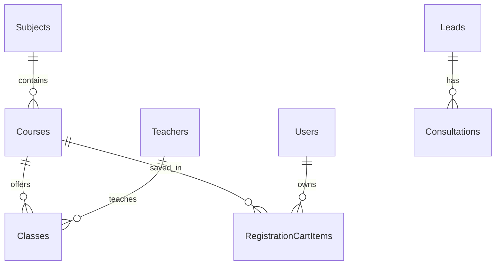

# Data Model: Course Catalog & Registration Cart (feat-course-catalog)

## 1. Entities Involved



### Entity: `RegistrationCartItem`
- Bảng: `dbo.RegistrationCartItems`
- Khóa chính: `id BIGINT IDENTITY(1,1)`
- Khóa ngoại:
  - `user_id BIGINT NOT NULL REFERENCES dbo.Users(id)`
  - `course_id BIGINT NOT NULL REFERENCES dbo.Courses(id)`
- Thuộc tính:
  - `quantity INT NOT NULL DEFAULT 1`
  - `notes NVARCHAR(500) NULL`
  - `created_at DATETIME2(0) NOT NULL DEFAULT GETDATE()`
- Ràng buộc: `UNIQUE (user_id, course_id)`

---

## 2. DTO Specifications

### 2.1 `CourseFilterDTO`
```java
public class CourseFilterDTO {
    private String keyword;
    private Long subjectId;
    private Integer gradeLevel;
    private BigDecimal minFee;
    private BigDecimal maxFee;
    private String sort; // "newest", "fee_asc", "fee_desc", "name_asc"
    private int page = 1;
    private int pageSize = 9;
}
```

### 2.2 `CourseCardDTO`
```java
public class CourseCardDTO {
    private Long id;
    private String code;
    private String name;
    private String subjectName;
    private String subjectCode;
    private Integer gradeLevel;
    private String targetExam;
    private BigDecimal fee;
    private Integer totalSessions;
    private Integer durationWeeks;
    private Integer maxCapacity;
    private String imageUrl;
    private boolean isFeatured;
    private String status;
    private int openClassCount;
}
```

### 2.3 `CartItemDTO`
```java
public class CartItemDTO {
    private Long courseId;
    private String courseCode;
    private String courseName;
    private String subjectName;
    private Integer gradeLevel;
    private BigDecimal fee;
    private Integer totalSessions;
    private String notes;
}
```

### 2.4 `CartViewDTO`
```java
public class CartViewDTO {
    private List<CartItemDTO> items = new ArrayList<>();
    private BigDecimal totalFee = BigDecimal.ZERO;
    private int totalCourses = 0;
}
```
