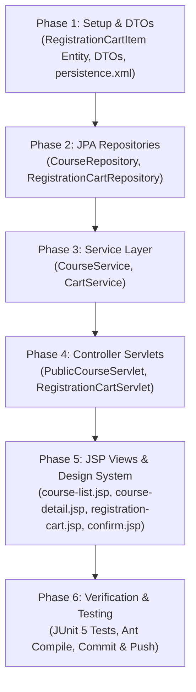

# Implementation Tasks: Course Catalog & Registration Cart (feat-course-catalog)
**Status:** Completed | **Feature:** `feat-course-catalog`  
**Spec Reference:** [spec.md](file:///d:/wd%20c%20sang%20d/Documents/NetBeansProjects/EduCenter/.sdd/specs/modules/admission/feat-course-catalog/spec.md) | **Plan Reference:** [plan.md](file:///d:/wd%20c%20sang%20d/Documents/NetBeansProjects/EduCenter/.sdd/specs/modules/admission/feat-course-catalog/plan.md)  
**Target Module:** `MOD-ADMISSION` | **Owner:** Member 02  

---

## Task Dependencies & Execution Flow

---

## Phase 1: Entity & DTOs

- [x] **TASK-01-01**: Tạo Entity `RegistrationCartItem.java` ánh xạ bảng `dbo.RegistrationCartItems` với quan hệ `@ManyToOne` sang `User` và `Course`.
- [x] **TASK-01-02**: Đăng ký Entity `RegistrationCartItem` vào file `src/conf/META-INF/persistence.xml`.
- [x] **TASK-01-03**: Tạo các DTO trong package `com.educenter.dto`:
  - `CourseFilterDTO.java`: Các tiêu chí tìm kiếm, lọc (keyword, subjectId, gradeLevel, minFee, maxFee, sort, page, pageSize).
  - `CourseCardDTO.java`: Dữ liệu hiển thị thẻ khóa học trên danh sách.
  - `CourseDetailDTO.java`: Chi tiết khóa học, lớp mở và khóa học liên quan.
  - `CartItemDTO.java` & `CartViewDTO.java`: Dữ liệu hiển thị giỏ đăng ký khóa học và tổng phí.
  - `RegistrationCheckoutDTO.java`: Form xác nhận gửi hồ sơ tuyển sinh.

---

## Phase 2: JPA Repositories

- [x] **TASK-02-01**: Mở rộng `CourseRepository.java`:
  - `searchCourses(EntityManager em, CourseFilterDTO filter)`: Xây dựng JPQL động lọc môn, khối, giá, từ khóa và sắp xếp kèm phân trang.
  - `countCourses(EntityManager em, CourseFilterDTO filter)`: Đếm tổng số bản ghi khớp tiêu chí.
  - `findByIdWithDetails(EntityManager em, Long id)`: Truy vấn chi tiết kèm môn học và danh sách lớp.
  - `findRelatedCourses(EntityManager em, Long subjectId, Integer gradeLevel, Long excludeCourseId, int limit)`: Lấy khóa học gợi ý.
- [x] **TASK-02-02**: Tạo `RegistrationCartRepository.java`:
  - `findByUserId(EntityManager em, Long userId)`
  - `findByUserAndCourse(EntityManager em, Long userId, Long courseId)`
  - `save(EntityManager em, RegistrationCartItem item)`
  - `delete(EntityManager em, Long id)`
  - `clearByUserId(EntityManager em, Long userId)`

---

## Phase 3: Service Layer

- [x] **TASK-03-01**: Tạo `CourseService.java` và `CourseServiceImpl.java`:
  - `getCourseCatalog(CourseFilterDTO filter)`: Trả về danh sách khóa học phân trang và danh mục môn học/khối lớp để render bộ lọc.
  - `getCourseDetail(Long courseId)`: Trả về chi tiết khóa học, danh sách lớp đang mở và các khóa học tương tự.
- [x] **TASK-03-02**: Tạo `CartService.java` và `CartServiceImpl.java`:
  - `getCart(HttpSession session, Long userId)`: Lấy giỏ hàng (hỗ trợ Session cho khách và DB cho tài khoản đăng nhập).
  - `addToCart(HttpSession session, Long userId, Long courseId, String notes)`: Thêm khóa học vào giỏ, chống trùng lặp.
  - `removeFromCart(HttpSession session, Long userId, Long courseId)`: Xóa khóa học khỏi giỏ.
  - `confirmRegistration(HttpSession session, Long userId, RegistrationCheckoutDTO checkoutDTO)`: Chuyển giỏ thành Lead, xóa giỏ và trả về Lead ID.

---

## Phase 4: Controller Servlets

- [x] **TASK-04-01**: Tạo `PublicCourseServlet.java`:
  - `GET /courses`: Hiển thị danh mục khóa học (`course-list.jsp`).
  - `GET /courses/detail`: Hiển thị chi tiết khóa học (`course-detail.jsp`).
  - `GET /consultation/success`: Hiển thị thông báo xác nhận tuyển sinh thành công (`consultation-success.jsp`).
- [x] **TASK-04-02**: Tạo `RegistrationCartServlet.java`:
  - `GET /registration-cart`: Hiển thị giỏ hàng (`registration-cart.jsp`).
  - `POST /registration-cart/add`: Thêm vào giỏ (PRG pattern).
  - `POST /registration-cart/remove`: Xóa khỏi giỏ (PRG pattern).
  - `GET /registration/confirm`: Hiển thị form xác nhận thông tin đăng ký (`registration-confirm.jsp`).
  - `POST /registration/confirm`: Xử lý submit xác nhận, tạo Lead, redirect sang `/consultation/success`.

---

## Phase 5: JSP Views & Design System (design.md)

- [x] **TASK-05-01**: Tạo `course-list.jsp` (PUB-02):
  - Thanh tìm kiếm, dropdown môn học, chọn khối lớp (chips 10, 11, 12, THCS), slider/khoảng học phí, dropdown sắp xếp.
  - Lưới Card khóa học (3 cột responsive), badge môn học, số buổi, học phí VNĐ, nút "Chi tiết" và "Thêm vào giỏ".
  - Thanh phân trang đồng bộ tham số URL.
  - Giao diện Empty State khi không tìm thấy khóa học.
- [x] **TASK-05-02**: Tạo `course-detail.jsp` (PUB-03):
  - Khung thông tin tổng quan, học phí, số buổi, sĩ số tối đa.
  - Bảng danh sách các lớp học đang mở tuyển sinh cho khóa này.
  - Khối gợi ý "Khóa học tương tự cùng môn/khối".
- [x] **TASK-05-03**: Tạo `registration-cart.jsp` (PUB-04):
  - Bảng danh sách khóa học đã chọn, học phí từng môn, nút xóa.
  - Hộp tóm tắt đơn đăng ký: tổng số môn, tổng học phí dự kiến, nút "Tiến hành đăng ký".
  - Empty State giỏ hàng trống kèm nút "Khám phá khóa học ngay".
- [x] **TASK-05-04**: Tạo `registration-confirm.jsp` (PUB-05) & `consultation-success.jsp` (PUB-07):
  - Form nhập họ tên, SĐT, email, khối lớp, ghi chú tư vấn (tự động điền nếu đã đăng nhập).
  - Màn hình thông báo thành công có mã số hồ sơ tuyển sinh.

---

## Phase 6: Verification & Testing

- [x] **TASK-06-01**: Viết JUnit 5 unit test `CourseServiceTest` kiểm tra tìm kiếm, lọc theo khối/môn, sắp xếp, phân trang.
- [x] **TASK-06-02**: Viết JUnit 5 unit test `CartServiceTest` kiểm tra thêm/xóa/tính tổng tiền giỏ hàng.
- [x] **TASK-06-03**: Chạy biên dịch Ant `ant compile` đảm bảo `BUILD SUCCESSFUL`.
- [x] **TASK-06-04**: Chạy toàn bộ test suite JUnit 5 đảm bảo tất cả test pass 100%.
- [x] **TASK-06-05**: Commit và push toàn bộ tính năng hoàn thiện lên nhánh `main`.
