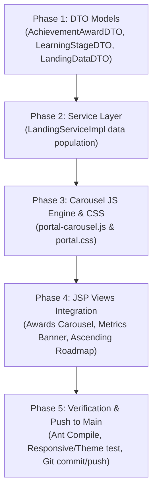

# Implementation Tasks: Landing Page Showcase & Interactive Achievements Pathway (feat-landing-showcase)
**Status:** In Progress | **Feature:** `feat-landing-showcase`  
**Spec Reference:** [spec.md](file:///d:/wd%20c%20sang%20d/Documents/NetBeansProjects/EduCenter/.sdd/specs/modules/admission/feat-landing-showcase/spec.md) | **Plan Reference:** [plan.md](file:///d:/wd%20c%20sang%20d/Documents/NetBeansProjects/EduCenter/.sdd/specs/modules/admission/feat-landing-showcase/plan.md)  
**Target Module:** `MOD-ADMISSION` | **Owner:** Member 02  

---

## Task Dependencies & Execution Flow

---

## Phase 1: Setup & Data Transfer Objects (DTOs)

- [x] T001 [P] Create `AchievementAwardDTO.java` in `src/java/com/educenter/dto/AchievementAwardDTO.java` representing academic awards, honors, and accreditations.
- [x] T002 [P] Create `LearningStageDTO.java` in `src/java/com/educenter/dto/LearningStageDTO.java` representing 4-stage ascending learning journey milestones.
- [x] T003 Extend `LandingDataDTO.java` in `src/java/com/educenter/dto/LandingDataDTO.java` with getters/setters for `achievementAwards` and `learningStages`.

---

## Phase 2: Service Layer Data Population

- [x] T004 Update `LandingServiceImpl.java` in `src/java/com/educenter/service/LandingServiceImpl.java` to construct and populate standardized achievement awards and learning roadmap stages in `getLandingPortalData()`.

---

## Phase 3: Interactive Carousel Engine & Stylesheet

- [x] T005 Create `portal-carousel.js` in `web/assets/js/portal-carousel.js` with pure Vanilla JavaScript supporting mouse drag (cursor grab/grabbing), touch swipe, arrow button navigation, and pagination dots.
- [x] T006 Add CSS design token styling for Awards Carousel, High-Contrast Metrics Banner, and Ascending Trajectory Roadmap in `web/assets/css/portal.css` adhering strictly to `design.md`.

---

## Phase 4: Landing Page UI Integration (JSP)

- [x] T007 Integrate Section 02B (Awards & Honors Showcase Carousel) into `web/WEB-INF/views/common/landing.jsp` with Lucide outline SVG icons and responsive controls.
- [x] T008 Integrate Section 02C (High-Contrast Academic Milestones Banner) into `web/WEB-INF/views/common/landing.jsp` displaying 5 major educational indicators connected to DB metrics.
- [x] T009 Integrate Section 03A (Ascending Learning Roadmap Pathway) into `web/WEB-INF/views/common/landing.jsp` visualizing the 4 stages with an upward trajectory arrow.
- [x] T010 Connect `portal-carousel.js` and initialize the slider in `web/WEB-INF/views/common/landing.jsp`.

---

## Phase 5: Verification, Quality Assurance & Git Sync

- [x] T011 Verify responsive layout across Mobile (360px), Tablet (768px), and Desktop (1440px), ensuring flawless theme compatibility in both Light (default) and Dark mode.
- [x] T012 Run Ant build to verify clean compilation with 0 errors.
- [x] T013 Commit and push code to `main` branch with message `feat(landing): showcase achievements, metrics banner and ascending roadmap`.
