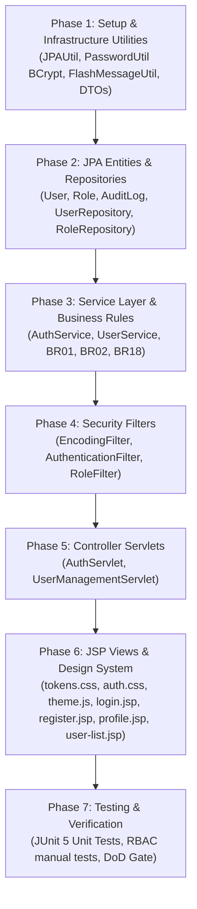

# Implementation Tasks: Authentication & Role-Based Access Control (feat-auth-rbac)

> **Artifact baseline: historical v1.** N?i dung/checkbox d??i ??y thu?c phi?n b?n tr??c; spec v2 hi?n h?nh l? [spec.md](spec.md). Ph?i c?p nh?t plan/tasks v? c?c h?p ??ng t??ng ?ng tr??c khi code v2; kh?ng d?ng tr?ng th?i Completed ho?c chi ti?t m?u thu?n ? ??y l?m b?ng ch?ng ?? ??t v2. H?p ??ng chung t?i [integration.md](../../../integration.md) v? th? t? tri?n khai t?i [implementation-order.md](../../../implementation-order.md).

**Status:** Completed & Verified | **Feature:** `feat-auth-rbac`
> Historical implementation checklist. Completion claims below are superseded by the 2026-10-23 [repair specification](../../admission/feat-portal-cart-repair/spec.md) and [verification](../../admission/feat-portal-cart-repair/verification.md); owner exclusions and unbuilt ERP modules are not production-complete.

**Spec Reference:** [spec.md](file:///d:/wd%20c%20sang%20d/Documents/NetBeansProjects/EduCenter/.sdd/specs/modules/finance-admin/feat-auth-rbac/spec.md) | **Plan Reference:** [plan.md](file:///d:/wd%20c%20sang%20d/Documents/NetBeansProjects/EduCenter/.sdd/specs/modules/finance-admin/feat-auth-rbac/plan.md)
**Target Module:** `MOD-FINANCE-ADMIN` | **Owner:** Member 03

---

## Task Dependencies & Execution Flow

---

## Phase 1: Setup & Infrastructure Utilities

- [x] **TASK-01-01**: Cài đặt / kiểm tra thư viện BCrypt (`jbcrypt`) trong dự án để băm mật khẩu theo chuẩn **SEC-01** (cost >= 10).
- [x] **TASK-01-02**: Tạo lớp [PasswordUtil.java](file:///d:/wd%20c%20sang%20d/Documents/NetBeansProjects/EduCenter/src/java/com/educenter/util/PasswordUtil.java) với các hàm:
  - `String hashPassword(String plainPassword)`
  - `boolean verifyPassword(String plainPassword, String hashedPassword)`
- [x] **TASK-01-03**: Tạo lớp [JPAUtil.java](file:///d:/wd%20c%20sang%20d/Documents/NetBeansProjects/EduCenter/src/java/com/educenter/util/JPAUtil.java) quản lý singleton `EntityManagerFactory` từ persistence unit `"EduCenterPU"`.
- [x] **TASK-01-04**: Tạo lớp [FlashMessageUtil.java](file:///d:/wd%20c%20sang%20d/Documents/NetBeansProjects/EduCenter/src/java/com/educenter/util/FlashMessageUtil.java) để gửi và xóa thông báo trong Session (hỗ trợ PRG pattern).
- [x] **TASK-01-05**: Tạo các DTO trong package `com.educenter.dto`:
  - [UserPrincipalDTO.java](file:///d:/wd%20c%20sang%20d/Documents/NetBeansProjects/EduCenter/src/java/com/educenter/dto/UserPrincipalDTO.java)
  - [LoginRequestDTO.java](file:///d:/wd%20c%20sang%20d/Documents/NetBeansProjects/EduCenter/src/java/com/educenter/dto/LoginRequestDTO.java)
  - [RegisterRequestDTO.java](file:///d:/wd%20c%20sang%20d/Documents/NetBeansProjects/EduCenter/src/java/com/educenter/dto/RegisterRequestDTO.java)
  - [ProfileUpdateDTO.java](file:///d:/wd%20c%20sang%20d/Documents/NetBeansProjects/EduCenter/src/java/com/educenter/dto/ProfileUpdateDTO.java)

---

## Phase 2: JPA Entities & Repositories

- [x] **TASK-02-01**: Tạo Entity [Role.java](file:///d:/wd%20c%20sang%20d/Documents/NetBeansProjects/EduCenter/src/java/com/educenter/entity/Role.java) ánh xạ bảng `dbo.Roles`.
- [x] **TASK-02-02**: Tạo Entity [User.java](file:///d:/wd%20c%20sang%20d/Documents/NetBeansProjects/EduCenter/src/java/com/educenter/entity/User.java) ánh xạ bảng `dbo.Users` với quan hệ `@ManyToMany` sang `Role` qua bảng `UserRoles`.
- [x] **TASK-02-03**: Tạo Entity [AuditLog.java](file:///d:/wd%20c%20sang%20d/Documents/NetBeansProjects/EduCenter/src/java/com/educenter/entity/AuditLog.java) ánh xạ bảng `dbo.AuditLogs`.
- [x] **TASK-02-04**: Khai báo các Entity mới vào file [persistence.xml](file:///d:/wd%20c%20sang%20d/Documents/NetBeansProjects/EduCenter/src/conf/META-INF/persistence.xml).
- [x] **TASK-02-05**: Tạo [RoleRepository.java](file:///d:/wd%20c%20sang%20d/Documents/NetBeansProjects/EduCenter/src/java/com/educenter/repository/RoleRepository.java) sử dụng JPA `EntityManager` và JPQL:
  - `Optional<Role> findByCode(String code)`
  - `List<Role> findAll()`
- [x] **TASK-02-06**: Tạo [UserRepository.java](file:///d:/wd%20c%20sang%20d/Documents/NetBeansProjects/EduCenter/src/java/com/educenter/repository/UserRepository.java) sử dụng JPA `EntityManager` và JPQL:
  - `Optional<User> findByEmail(String email)` (dùng `JOIN FETCH u.roles` tránh LazyInitializationException)
  - `boolean existsByEmail(String email)`
  - `List<User> searchUsers(String keyword, String roleCode, String status, int offset, int limit)`
  - `long countUsers(String keyword, String roleCode, String status)`
  - `void save(User user)`, `void update(User user)`

---

## Phase 3: Service Layer & Business Rules

- [x] **TASK-03-01**: Tạo [AuthService.java](file:///d:/wd%20c%20sang%20d/Documents/NetBeansProjects/EduCenter/src/java/com/educenter/service/AuthService.java) và lớp triển khai `AuthServiceImpl.java`:
  - `login(String email, String password)`: Kiểm tra tài khoản, xác thực BCrypt, chặn tài khoản `LOCKED`, trả về `UserPrincipalDTO`.
  - `register(RegisterRequestDTO dto)`: Kiểm tra trùng email (**BR01**), băm mật khẩu, gán vai trò mặc định, lưu CSDL trong transaction.
  - `changePassword(Long userId, String oldPassword, String newPassword)`: Xác thực pass cũ, băm pass mới.
- [x] **TASK-03-02**: Tạo [UserService.java](file:///d:/wd%20c%20sang%20d/Documents/NetBeansProjects/EduCenter/src/java/com/educenter/service/UserService.java) và lớp triển khai `UserServiceImpl.java`:
  - `updateProfile(Long userId, ProfileUpdateDTO dto)`: Cập nhật thông tin cá nhân.
  - `toggleUserStatus(Long adminId, Long targetUserId, String newStatus)`: Khóa/mở khóa tài khoản + ghi `AuditLogs` (**BR18**).
  - `assignRoles(Long adminId, Long targetUserId, Set<String> roleCodes)`: Phân quyền + ghi `AuditLogs` (**BR18**).
  - `getUserList(String keyword, String roleCode, String status, int page, int pageSize)`

---

## Phase 4: Security Filters Pipeline

- [x] **TASK-04-01**: Tạo [EncodingFilter.java](file:///d:/wd%20c%20sang%20d/Documents/NetBeansProjects/EduCenter/src/java/com/educenter/filter/EncodingFilter.java) ép kiểu UTF-8 cho mọi request/response.
- [x] **TASK-04-02**: Tạo [AuthenticationFilter.java](file:///d:/wd%20c%20sang%20d/Documents/NetBeansProjects/EduCenter/src/java/com/educenter/filter/AuthenticationFilter.java) kiểm tra `currentUser` trong session cho các URL `/admin/*`, `/staff/*`, `/teacher/*`, `/student/*`, `/parent/*`, `/profile`.
- [x] **TASK-04-03**: Tạo [RoleFilter.java](file:///d:/wd%20c%20sang%20d/Documents/NetBeansProjects/EduCenter/src/java/com/educenter/filter/RoleFilter.java) kiểm tra quyền RBAC theo bảng ma trận URL, chuyển hướng `/errors/403` khi truy cập trái quyền.
- [x] **TASK-04-04**: Cấu hình filter chain trong [web.xml](file:///d:/wd%20c%20sang%20d/Documents/NetBeansProjects/EduCenter/web/WEB-INF/web.xml).

---

## Phase 5: Controller Servlets (PRG Pattern)

- [x] **TASK-05-01**: Tạo [AuthServlet.java](file:///d:/wd%20c%20sang%20d/Documents/NetBeansProjects/EduCenter/src/java/com/educenter/controller/AuthServlet.java) kế thừa `HttpServlet`:
  - Xử lý routes: `/login`, `/register`, `/logout`, `/forgot-password`, `/reset-password`, `/profile`.
  - Áp dụng Post/Redirect/Get với flash message qua `FlashMessageUtil`.
- [x] **TASK-05-02**: Tạo [UserManagementServlet.java](file:///d:/wd%20c%20sang%20d/Documents/NetBeansProjects/EduCenter/src/java/com/educenter/controller/UserManagementServlet.java):
  - Xử lý route: `/admin/users`, `/admin/users/status`, `/admin/users/roles`.

---

## Phase 6: JSP Views & Design System Assets (Tuân Thủ 100% design.md)

- [x] **TASK-06-01**: Tạo file CSS Design Tokens [tokens.css](file:///d:/wd%20c%20sang%20d/Documents/NetBeansProjects/EduCenter/web/assets/css/tokens.css) chứa đầy đủ biến CSS Light/Dark mode từ `design.md`.
- [x] **TASK-06-02**: Tạo file JavaScript [theme.js](file:///d:/wd%20c%20sang%20d/Documents/NetBeansProjects/EduCenter/web/assets/js/theme.js) xử lý mặc định Light mode và lưu `localStorage['educenter-theme']`.
- [x] **TASK-06-03**: Tạo file CSS [auth.css](file:///d:/wd%20c%20sang%20d/Documents/NetBeansProjects/EduCenter/web/assets/css/auth.css) cho các form đăng nhập, đăng ký dạng Card 440px theo phong cách SaaS chuyên nghiệp.
- [x] **TASK-06-04**: Tạo JSP component dùng chung:
  - [alert.jsp](file:///d:/wd%20c%20sang%20d/Documents/NetBeansProjects/EduCenter/web/WEB-INF/views/common/alert.jsp): Hiển thị thông báo thành công / lỗi.
  - [403.jsp](file:///d:/wd%20c%20sang%20d/Documents/NetBeansProjects/EduCenter/web/WEB-INF/views/common/403.jsp): Giao diện báo lỗi từ chối truy cập.
- [x] **TASK-06-05**: Xây dựng các trang JSP giao diện Auth (sử dụng icon outline SVG Lucide, không emoji, không Tailwind CDN):
  - [login.jsp](file:///d:/wd%20c%20sang%20d/Documents/NetBeansProjects/EduCenter/web/WEB-INF/views/auth/login.jsp) (AUTH-01)
  - [register.jsp](file:///d:/wd%20c%20sang%20d/Documents/NetBeansProjects/EduCenter/web/WEB-INF/views/auth/register.jsp) (AUTH-02)
  - [forgot-password.jsp](file:///d:/wd%20c%20sang%20d/Documents/NetBeansProjects/EduCenter/web/WEB-INF/views/auth/forgot-password.jsp) (AUTH-03)
  - [reset-password.jsp](file:///d:/wd%20c%20sang%20d/Documents/NetBeansProjects/EduCenter/web/WEB-INF/views/auth/reset-password.jsp) (AUTH-04)
  - [profile.jsp](file:///d:/wd%20c%20sang%20d/Documents/NetBeansProjects/EduCenter/web/WEB-INF/views/auth/profile.jsp) (AUTH-05)
- [x] **TASK-06-06**: Xây dựng trang quản trị người dùng [user-list.jsp](file:///d:/wd%20c%20sang%20d/Documents/NetBeansProjects/EduCenter/web/WEB-INF/views/admin/user-list.jsp) (ADM-18) với bảng danh sách, bộ lọc role, tìm kiếm và nút khóa/mở tài khoản.

---

## Phase 7: Verification & Testing

- [x] T001 Implement FR-001..FR-007 supplement: CSRF, session renewal/revocation, safe redirect and last ACTIVE ADMIN protection in src/java/com/educenter.
- [x] T002 Implement FR-004 password recovery entity/repository/service/SMTP/controller/JSP and non-destructive SQL migration; test expiry/reuse/locked account.
- [x] T003 Supply reproducible Ant dependency bootstrap, Java 17 WAR packaging and isolated JPA/HTTP/JSP tests per SC-001/SC-002.
- [x] T004 Document environment configuration, SQL migration, SMTP, role landing routes and independent SQL Server/browser acceptance in quickstart.md.

- [x] **TASK-07-01**: Viết JUnit 5 test `PasswordUtilTest` kiểm tra độ tin cậy của thuật toán băm BCrypt.
- [x] **TASK-07-02**: Viết JUnit 5 test `AuthServiceTest` kiểm thử các luồng đăng nhập, đăng ký, bắt lỗi email trùng, bắt lỗi tài khoản khóa.
- [x] **TASK-07-03**: Kiểm thử thủ công trên trình duyệt:
  - Kiểm tra giao diện lần đầu luôn là Light mode (kể cả khi Windows bật Dark mode).
  - Đăng ký tài khoản học sinh mới -> Đăng nhập -> Kiểm tra chuyển hướng đúng.
  - Thử truy cập `/admin/users` bằng tài khoản Student -> Kiểm tra chuyển về trang 403.
- [x] **TASK-07-04**: Rà soát tiêu chí Definition of Done (DoD).
- [x] **TASK-07-05**: Commit và push toàn bộ tính năng hoàn thiện lên nhánh `main`.
