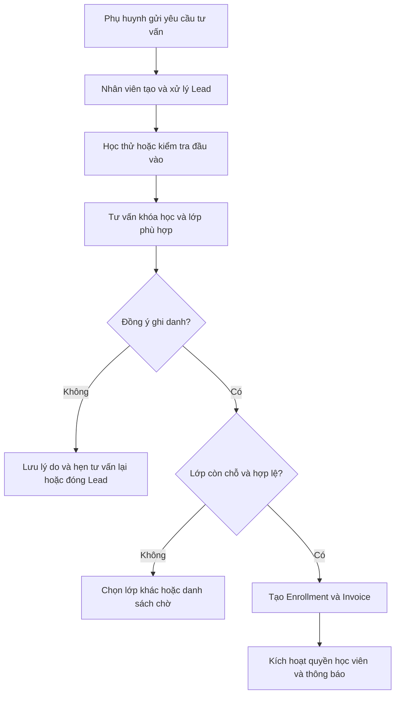
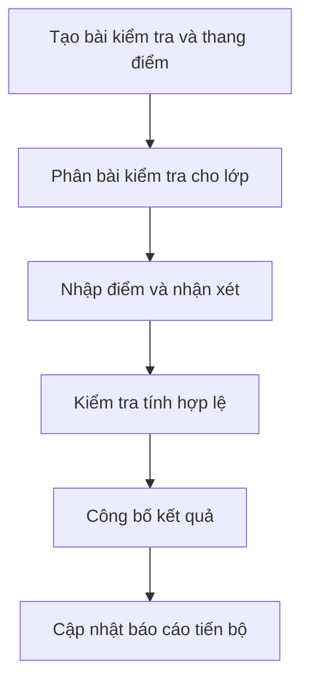
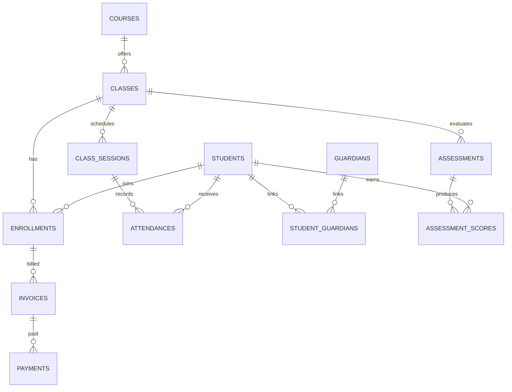
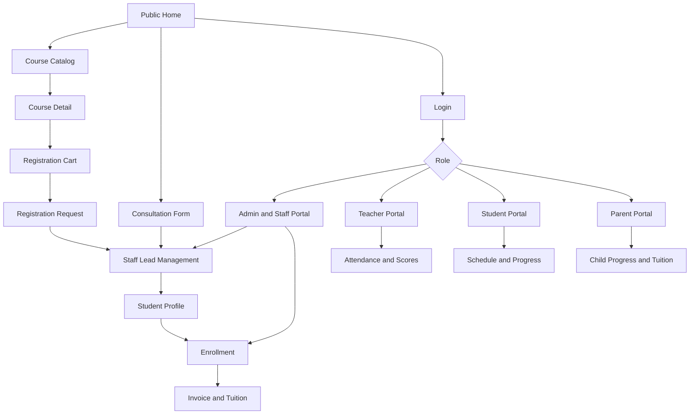
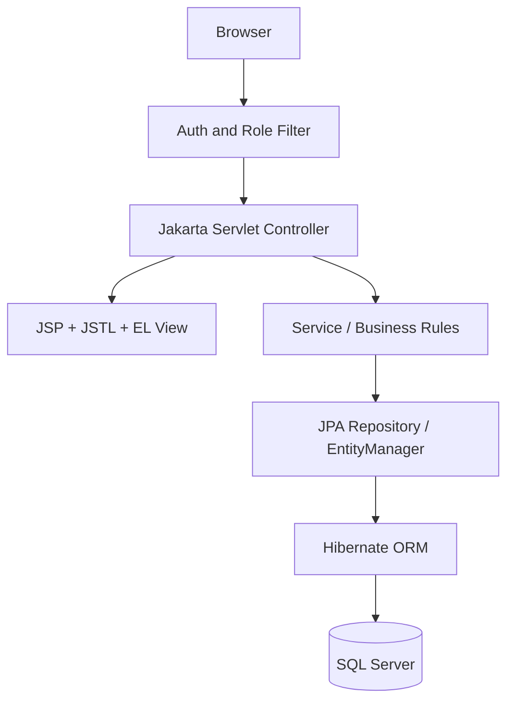

# EDUCENTER – TUTORING & EXAM PREPARATION MANAGEMENT SYSTEM

**BẢN ĐẶC TẢ YÊU CẦU PHẦN MỀM (SRS) & KẾ HOẠCH TRIỂN KHAI**  
**Phiên bản:** 1.1 | **Ngày:** 22/10/2026  
**Loại dự án:** Java Web Application | **Nhóm:** 3 thành viên | **Dự kiến:** 10 tuần  
**Đối tượng:** Trung tâm gia sư, bổ trợ kiến thức và luyện thi  
**Trạng thái:** Đề xuất để trao đổi với khách hàng/giảng viên, chưa phải hợp đồng hoặc phạm vi đã phê duyệt.

> **Lưu ý về Assignment PRJ301:** Phần yêu cầu ASM ở cuối tài liệu được tổng hợp từ file `Assignment_Loan.pdf`. Theo yêu cầu biên soạn, **không đưa mục 3.7 “Nâng cao / Framework” vào bảng tiêu chí đánh giá**. Đề gốc vẫn có mục đó (1,0 điểm); vì vậy bản rút gọn này **không đại diện cho toàn bộ thang điểm chính thức**. Các mục còn lại có tổng điểm 9,0. Yêu cầu nền tảng **Java Web + SQL Server + JPA (không dùng JDBC thuần)** vẫn được giữ nguyên.

---

## I. Tổng quan dự án

### 1. Tầm nhìn sản phẩm

EduCenter là hệ thống quản lý tập trung dành cho trung tâm gia sư và luyện thi THCS, THPT, ôn thi vào lớp 10, tốt nghiệp THPT và các lớp bổ trợ kiến thức. Hệ thống kết hợp ba nhóm nghiệp vụ:

- **Tuyển sinh:** giới thiệu khóa học, tiếp nhận nhu cầu, tư vấn, kiểm tra đầu vào và đăng ký học.
- **Đào tạo:** quản lý học viên, giáo viên, lớp, lịch học, điểm danh, kiểm tra và tiến độ.
- **Điều hành:** học phí, công nợ, phụ huynh, báo cáo, quản lý tài khoản và vận hành.

### 2. Bài toán thực tế

Các trung tâm thường lưu thông tin học viên, giáo viên, lịch học và học phí rải rác trong Excel, Google Sheets, Zalo. Hệ quả là khó tra cứu hồ sơ, dễ trùng lịch, khó tổng hợp công nợ, phụ huynh thiếu kênh theo dõi tập trung, và quản lý thiếu số liệu điều hành.

**Giải pháp:** Một hệ thống web với cơ sở dữ liệu tập trung, phân quyền theo bộ phận, kết nối quy trình từ khách hàng tiềm năng đến học tập và thanh toán.

### 3. Mục tiêu

| Mục tiêu | Kết quả mong muốn |
|---|---|
| Số hóa dữ liệu | Hồ sơ tập trung, dễ tra cứu, giảm thao tác thủ công |
| Tối ưu tuyển sinh | Theo dõi Lead từ tư vấn đến ghi danh |
| Quản lý đào tạo | Theo dõi lớp, lịch, chuyên cần, điểm và tiến bộ |
| Minh bạch tài chính | Quản lý số phải thu, đã thu và công nợ |
| Kết nối phụ huynh | Theo dõi thông tin con trong phạm vi được phép |
| Hỗ trợ điều hành | Dashboard phản ánh hoạt động và hiệu quả trung tâm |

### 4. Phạm vi

**MVP:** Một trung tâm, một cơ sở; nhiều môn và khối lớp; lớp nhóm và gia sư 1-1; website tuyển sinh kết hợp cổng quản lý nội bộ.

**Chưa nằm trong MVP:** Nhiều chi nhánh, video learning trực tuyến, AI chấm bài, payroll phức tạp, mobile app native, cổng thanh toán ngân hàng thật.

---

## II. Vai trò và phân quyền

| Vai trò | Trách nhiệm |
|---|---|
| **System Admin** | Cấu hình, tài khoản, phân quyền, nhật ký hệ thống |
| **Center Manager** | Điều hành, phê duyệt, xem báo cáo và doanh thu |
| **Academic / Admission Staff** | Tư vấn, tuyển sinh, hồ sơ, xếp lớp, học phí, chăm sóc |
| **Tutor / Teacher** | Lịch dạy, điểm danh, bài kiểm tra, điểm, nhận xét |
| **Student** | Xem lớp, lịch, bài tập, kết quả, học phí, Q&A |
| **Parent / Guardian** | Theo dõi con, chuyên cần, điểm, học phí, thông báo |

> Trong MVP, quyền System Admin có thể gộp với quản trị trung tâm; Staff có thể tách thành tuyển sinh, học vụ, kế toán khi mở rộng.

### Ma trận phân quyền

| Chức năng | Admin / Manager | Staff | Teacher | Student / Parent |
|---|---|---|---|---|
| Tài khoản | Quản trị / theo quyền | Giới hạn | Cá nhân | Cá nhân |
| Khóa học | CRUD | Xem / sửa theo quyền | Xem | Xem |
| CRM | Toàn quyền | CRUD | Học thử được giao | Gửi yêu cầu |
| Lớp / lịch | Toàn quyền | CRUD theo quyền | Lớp được giao | Lớp của mình |
| Điểm danh | Xem / điều chỉnh có kiểm soát | Xem | Ghi nhận | Xem |
| Điểm số | Xem / duyệt | Xem theo quyền | Nhập / công bố | Xem điểm công bố |
| Học phí | Quản lý / báo cáo | Thu và ghi nhận | Không | Xem liên quan |
| Báo cáo | Toàn trung tâm | Theo nghiệp vụ | Theo lớp | Cá nhân |
| Q&A | Kiểm duyệt | Trả lời / duyệt theo quyền | Trả lời | Đặt câu hỏi |

**Yêu cầu bảo mật:** Backend kiểm tra quyền trên từng chức năng và từng bản ghi; không chỉ ẩn nút trên giao diện. Người giám hộ chỉ xem học viên đã được xác thực liên kết.

---

## III. Đặc tả 12 module

### M01 – Public Website & Course Catalog

**Mục tiêu:** Thu hút và chuyển đổi người quan tâm thành học viên.

- Trang chủ: giới thiệu trung tâm, giáo viên, khóa học nổi bật/mới mở.
- Danh sách khóa học theo môn Toán, Văn, Anh, Lý, Hóa…, khối 6–12 và mục tiêu thi.
- Tìm kiếm từ khóa, lọc môn/khối/mức phí, sắp xếp, phân trang.
- Trang chi tiết: mục tiêu, nội dung, số buổi, lịch dự kiến, học phí, sĩ số.
- Gợi ý khóa học tương tự.
- Form đăng ký tư vấn, kiểm tra đầu vào.
- Danh sách chọn khóa học đăng ký: thêm, bỏ, cập nhật lựa chọn, tổng học phí dự kiến.

### M02 – Authentication & Account Management

- Đăng ký, đăng nhập, đăng xuất.
- Quên/đặt lại mật khẩu, đổi mật khẩu, cập nhật hồ sơ.
- Quản lý vai trò, trạng thái khóa/mở tài khoản.
- Một phụ huynh có thể liên kết nhiều học viên; một học viên có thể có nhiều người giám hộ.
- Mật khẩu lưu dạng hash an toàn, kiểm tra phân quyền ở server.

### M03 – Admission & CRM

- Tiếp nhận khách hàng tiềm năng (Lead) từ website/nhân viên.
- Phân công tư vấn viên, nguồn tuyển sinh, lịch sử liên hệ.
- Đặt lịch học thử hoặc kiểm tra đầu vào; ghi nhận kết quả.
- Quản lý trạng thái `NEW → CONTACTED → ASSESSED → CONSULTING → ENROLLED`, nhánh `LOST`.
- Chuyển Lead thành hồ sơ học viên và ghi danh.

### M04 – Academic Programs & Courses

- CRUD môn học, chương trình, khóa học.
- Khối lớp, mục tiêu thi, trình độ, thời lượng, số buổi, học phí, mô tả, trạng thái tuyển sinh.
- Ví dụ: Toán 12 – Ôn thi tốt nghiệp THPT; 24 buổi; 90 phút/buổi; tối đa 15 học viên.

### M05 – Class & Timetable Management

- Tạo lớp, chọn khóa học, phân giáo viên chính, phòng, sĩ số tối đa.
- Tạo lịch định kỳ và sinh các buổi học cụ thể.
- Kiểm tra trùng giáo viên, phòng, lịch học viên.
- Đổi lịch, học bù, giáo viên dạy thay, chuyển lớp, bảo lưu, kết thúc lớp.
- Hỗ trợ lớp nhóm và lớp 1-1.

### M06 – Student & Guardian Management

- Hồ sơ học viên, trường học, khối lớp, mục tiêu điểm số, thông tin liên hệ.
- Hồ sơ phụ huynh và xác thực quan hệ giám hộ.
- Lịch sử đăng ký, trạng thái học, bảo lưu, nghỉ học, chuyển lớp.
- Tra cứu tiến độ và thông tin học viên theo quyền.

### M07 – Attendance & Teaching Journal

- Giáo viên mở buổi học được phân công và điểm danh.
- Trạng thái: `PRESENT`, `ABSENT_EXCUSED`, `ABSENT_UNEXCUSED`, `LATE`.
- Ghi nội dung giảng dạy, bài tập về nhà, nhận xét.
- Tỷ lệ chuyên cần theo học viên, lớp, giai đoạn.

### M08 – Assessment & Learning Progress

- Kiểm tra đầu vào, giữa khóa, cuối khóa và bài kiểm tra định kỳ.
- Tạo bài kiểm tra, thang điểm, nhập điểm, nhận xét, công bố kết quả.
- So sánh điểm đầu vào và điểm theo thời gian; biểu đồ tiến bộ.
- Ví dụ: 5,5 → 7,0 → 8,0; tăng 2,5 điểm so với đầu vào.

### M09 – Tuition & Payment

- Học phí niêm yết, ưu đãi, hóa đơn, các khoản thu.
- Ghi nhận thanh toán từng đợt, phương thức và chứng từ tham chiếu.
- Theo dõi số đã thu, còn nợ, lịch sử thanh toán, biên lai nội bộ.
- Không tích hợp cổng ngân hàng thật trong MVP.
- Không xóa lịch sử giao dịch; điều chỉnh có nhật ký.

### M10 – Notifications & Q&A

- Thông báo đổi lịch, nghỉ học, học phí đến hạn, kết quả học tập.
- Học viên/phụ huynh đặt câu hỏi về khóa học hoặc lịch học.
- Nhân viên/giáo viên/admin trả lời theo quyền.
- Kiểm duyệt nội dung trước khi hiển thị công khai; duyệt, từ chối, ẩn.

### M11 – Dashboard & Reporting

- Tổng học viên, học viên mới, lớp hoạt động, số buổi học.
- Tỷ lệ chuyển đổi tuyển sinh, tỷ lệ chuyên cần.
- Doanh thu đã thu, số phải thu, công nợ.
- Điểm trung bình, lớp đông/ít nhất, khóa học có nhiều lượt đăng ký.
- Báo cáo dùng đủ `MAX`, `MIN`, `AVG`, `SUM`, `COUNT`.

### M12 – System Administration

- Quản lý người dùng, vai trò, danh mục, phòng học.
- Cấu hình thông số học phí, giới hạn nghiệp vụ.
- Audit Logs: ai thao tác, lúc nào, thay đổi gì.
- Khóa/mở tài khoản, quản lý trạng thái hệ thống.

---

## IV. Quy trình nghiệp vụ

### WF-01 – Tuyển sinh và ghi danh



**Ngoại lệ:** Lớp đủ sĩ số, ghi danh trùng, lớp đã đóng hoặc dữ liệu không hợp lệ. Ghi danh và tạo hóa đơn cần xử lý transaction nhất quán; bảo vệ thao tác đồng thời.

### WF-02 – Tổ chức buổi học

1. Hệ thống sinh buổi học từ lịch lớp.
2. Giáo viên xem lịch và buổi được phân công.
3. Giáo viên điểm danh học viên.
4. Giáo viên ghi nội dung dạy, bài tập, nhận xét.
5. Hoàn tất buổi học.
6. Học viên/phụ huynh xem dữ liệu được công bố.

**Ngoại lệ:** Giáo viên nghỉ; nhân viên đổi lịch hoặc chỉ định giáo viên thay, kiểm tra xung đột.

### WF-03 – Kiểm tra và đánh giá



### WF-04 – Thu học phí

1. Tạo hóa đơn từ ghi danh, áp dụng giảm giá đã duyệt.
2. Nhân viên ghi nhận thanh toán và mã/chứng từ tham chiếu.
3. Hệ thống kiểm tra số tiền, tính số dư còn nợ.
4. Cập nhật trạng thái hóa đơn và biên lai nội bộ.
5. Báo cáo tách tiền đã thu và khoản phải thu.

**Ngoại lệ:** Thanh toán trùng, thanh toán vượt dư nợ, nhập sai số tiền; xử lý điều chỉnh/hoàn tiền có Audit Log.

### WF-05 – Phụ huynh theo dõi học viên

Phụ huynh đăng nhập → chọn học viên đã liên kết → xem lịch, điểm danh, điểm, nhận xét, học phí → gửi câu hỏi/thông báo cho trung tâm. Chặn mọi truy cập sang học viên không liên kết.

---

## V. Danh sách 35 Use Case

**P0:** bắt buộc cho MVP. **P1:** bổ sung khi P0 ổn định.

| ID | Use Case | Actor | Ưu tiên |
|---|---|---|---|
| UC01 | Đăng ký tài khoản | Guest | P0 |
| UC02 | Đăng nhập, đăng xuất | All | P0 |
| UC03 | Quên, đổi mật khẩu | All | P0 |
| UC04 | Cập nhật hồ sơ | All | P0 |
| UC05 | Quản lý tài khoản, vai trò | Admin | P0 |
| UC06 | Xem, tìm kiếm, lọc khóa học | Guest / All | P0 |
| UC07 | Xem chi tiết và khóa học liên quan | Guest / All | P0 |
| UC08 | Quản lý danh sách khóa học đăng ký | Student / Parent | P0 |
| UC09 | Gửi yêu cầu tư vấn | Guest | P0 |
| UC10 | Quản lý Lead và lịch sử tư vấn | Staff | P0 |
| UC11 | Quản lý môn học, khóa học | Manager / Staff | P0 |
| UC12 | Quản lý giáo viên | Manager / Staff | P0 |
| UC13 | Quản lý học viên, phụ huynh | Staff | P0 |
| UC14 | Liên kết phụ huynh – học viên | Staff | P0 |
| UC15 | Tạo, sửa, đóng lớp | Staff | P0 |
| UC16 | Xếp lịch, kiểm tra xung đột | Staff | P0 |
| UC17 | Ghi danh học viên | Staff | P0 |
| UC18 | Chuyển lớp, bảo lưu | Staff | P1 |
| UC19 | Xem lịch học | Người liên quan | P0 |
| UC20 | Điểm danh | Teacher | P0 |
| UC21 | Ghi nhật ký giảng dạy | Teacher | P1 |
| UC22 | Tạo bài kiểm tra | Teacher | P0 |
| UC23 | Nhập, công bố điểm | Teacher | P0 |
| UC24 | Xem kết quả học tập | Student / Parent | P0 |
| UC25 | Tạo hóa đơn học phí | Staff | P0 |
| UC26 | Ghi nhận thanh toán | Staff | P0 |
| UC27 | Xem công nợ, lịch sử đóng tiền | Staff / Parent | P0 |
| UC28 | Tạo, nhận thông báo | Staff / All | P1 |
| UC29 | Gửi câu hỏi | Student / Parent | P0 |
| UC30 | Trả lời, kiểm duyệt Q&A | Teacher / Staff / Admin | P0 |
| UC31 | Thống kê tuyển sinh | Manager | P0 |
| UC32 | Thống kê học phí | Manager | P0 |
| UC33 | Thống kê chuyên cần, điểm | Manager / Teacher | P0 |
| UC34 | Quản lý phòng học | Staff | P0 |
| UC35 | Xem nhật ký thao tác | Admin | P1 |

### Đặc tả UC17 – Ghi danh học viên vào lớp

| Thuộc tính | Nội dung |
|---|---|
| Actor | Admission Staff |
| Tiền điều kiện | Nhân viên đăng nhập; học viên và lớp tồn tại |
| Trigger | Nhân viên chọn “Ghi danh” |
| Đầu vào | Học viên, lớp, ngày bắt đầu, chính sách học phí |
| Luồng chính | Kiểm tra lớp → sĩ số → trùng ghi danh → tạo Enrollment → tạo Invoice |
| Hậu điều kiện | Enrollment và Invoice hợp lệ, có thể tra cứu |
| Ngoại lệ | Lớp đầy, đã ghi danh, lớp đóng, lỗi dữ liệu |
| Yêu cầu kỹ thuật | Transaction và kiểm soát đồng thời để không vượt sĩ số |

---

## VI. Business Rules

**Các quy tắc sau là đề xuất, cần khách hàng xác nhận trước khi chốt SRS.**

| Mã | Quy tắc |
|---|---|
| BR01 | Email đăng nhập duy nhất |
| BR02 | Không truy cập dữ liệu ngoài quyền được cấp |
| BR03 | Không ghi danh trùng cùng lớp khi ghi danh cũ còn hiệu lực |
| BR04 | Số học viên đang học không vượt sĩ số tối đa |
| BR05 | Giáo viên không có hai buổi dạy trùng giờ |
| BR06 | Phòng học không có hai buổi sử dụng trùng giờ |
| BR07 | Học viên không có hai lớp trùng giờ nếu không được duyệt ngoại lệ |
| BR08 | Mỗi học viên tối đa một bản ghi điểm danh/buổi |
| BR09 | Chỉ giáo viên được giao hoặc người có quyền mới nhập/sửa điểm |
| BR10 | Điểm nằm trong thang điểm hợp lệ |
| BR11 | Điểm chưa công bố không hiển thị cho học viên/phụ huynh |
| BR12 | Công nợ = tổng phải thu − tổng thanh toán hợp lệ |
| BR13 | Thanh toán có người xác nhận và thời điểm xác nhận |
| BR14 | Không thanh toán vượt số phải thu nếu chưa có quy trình trả trước |
| BR15 | Phụ huynh chỉ xem học viên đã liên kết hợp lệ |
| BR16 | Dữ liệu đã phát sinh giao dịch không được xóa vật lý tùy tiện |
| BR17 | Q&A công khai phải được duyệt |
| BR18 | Sửa học phí, công bố điểm, đổi vai trò phải ghi Audit Log |
| BR19 | Lớp kết thúc không tạo thêm buổi học thông thường |
| BR20 | Báo cáo tách tiền đã thu và tiền còn phải thu |

### Ví dụ quy tắc kiểm tra lịch

Một giáo viên đã có lịch **Thứ Hai 18:00–19:30**, phòng 101. Không cho tạo buổi mới có cùng giáo viên **hoặc** cùng phòng và thời gian giao nhau. Điều kiện chồng lấn: `newStart < existingEnd AND newEnd > existingStart`.

---

## VII. Database – SQL Server

### 1. Danh sách 30 bảng đề xuất

| Nhóm | Bảng | Trường quan trọng |
|---|---|---|
| Identity | Users | id, email, password_hash, status |
| Identity | Roles | id, code, name |
| Identity | UserRoles | user_id, role_id |
| CRM | Leads | id, name, phone, source, status, assigned_to |
| CRM | Consultations | id, lead_id, staff_id, notes, contacted_at |
| Academic | Subjects | id, name, code |
| Academic | Courses | id, subject_id, grade_level, fee, duration |
| Academic | Classes | id, course_id, teacher_id, capacity, status |
| Academic | Rooms | id, name, capacity |
| Academic | ClassSessions | id, class_id, room_id, teacher_id, start_at, end_at |
| People | Students | id, user_id, full_name, grade_level, school |
| People | Guardians | id, user_id, full_name, phone |
| People | StudentGuardians | student_id, guardian_id, relationship |
| People | Teachers | id, user_id, specialization, status |
| Enrollment | Enrollments | id, student_id, class_id, status, enrolled_at |
| Enrollment | RegistrationCartItems | id, user_id, course_id, quantity |
| Learning | Attendances | id, session_id, student_id, status |
| Learning | TeachingJournals | id, session_id, content, homework |
| Learning | Assessments | id, class_id, title, max_score, status |
| Learning | AssessmentScores | id, assessment_id, student_id, score |
| Finance | Invoices | id, enrollment_id, total_amount, status |
| Finance | InvoiceItems | id, invoice_id, description, amount |
| Finance | Payments | id, invoice_id, amount, method, paid_at |
| Finance | Discounts | id, code, type, value, status |
| Communication | Questions | id, user_id, course_id, content, status |
| Communication | Answers | id, question_id, user_id, content, status |
| Communication | Notifications | id, recipient_id, title, content, read_at |
| Operations | AuditLogs | id, actor_id, action, entity_type, entity_id |
| Operations | SystemSettings | id, setting_key, setting_value |
| Operations | TrialAssessments | id, lead_id, subject_id, score, notes |

### 2. ERD rút gọn



### 3. Ràng buộc và lưu ý thiết kế

- Khóa chính dùng `BIGINT IDENTITY` hoặc UUID thống nhất.
- `Users.email` duy nhất; chuẩn hóa email theo quy tắc nhất quán.
- `Attendances(session_id, student_id)` unique.
- `AssessmentScores(assessment_id, student_id)` unique.
- Chặn ghi danh trùng **đang hiệu lực** bằng logic nghiệp vụ và ràng buộc phù hợp.
- `Payments.amount > 0`; `Classes.capacity > 0`; `ClassSessions.end_at > start_at`; `Invoices.total_amount >= 0`.
- Thêm `created_at`, `updated_at`, khóa ngoại, chỉ mục, soft delete khi phù hợp.
- `Classes.teacher_id` là giáo viên chính; `ClassSessions.teacher_id` là giáo viên thực dạy, hỗ trợ dạy thay.
- Dùng transaction và khóa/kiểm soát đồng thời cho ghi danh, xác nhận thanh toán.
- Với học phí dùng kiểu số chính xác (`DECIMAL` trong SQL Server, `BigDecimal` trong Java).
- Dữ liệu thanh toán nên có trạng thái xác nhận và luồng điều chỉnh/hoàn tiền; không chỉ lưu `paid_at`.

---

## VIII. Danh sách màn hình và luồng điều hướng (UI/UX Specification)

### 1. Quy ước chung

- **Stack UI:** JSP (`.jsp`), JSTL (`jakarta.tags.core`, `jakarta.tags.fmt`, `jakarta.tags.functions`), HTML5, CSS3, JavaScript, Bootstrap 5 (tùy chọn).
- **Rendering:** Servlet Controller xử lý request, lấy dữ liệu từ Service/JPA, đặt thuộc tính vào `request`, rồi `forward` tới JSP dưới `WEB-INF/views/`. Form POST về Servlet, xử lý xong `redirect` (Post/Redirect/Get).
- **Layout:** header/footer/navbar/sidebar dùng JSP fragment (`<jsp:include>`); JSTL `<c:forEach>`, `<c:if>`, `<c:choose>`, `<c:url>`, `<fmt:formatNumber>`; dùng EL `${...}` thay vì Java scriptlet trong JSP.
- **Phân quyền:** URL được bảo vệ bằng Servlet Filter và kiểm tra quyền ở Service; menu ẩn theo role chỉ là hỗ trợ giao diện.
- **Màn hình danh sách:** tìm kiếm, lọc, sắp xếp, phân trang, thông báo kết quả, trạng thái rỗng; màn hình form có validation cả client và server.
- **Quy ước:** `GET` hiển thị; `POST` tạo/cập nhật/thao tác; route dưới đây là đề xuất thống nhất cho nhóm, không phải API đã triển khai.

### 2. Danh mục màn hình chi tiết (Screen Inventory)

| ID | Màn hình | URL (GET) | Vai trò | Chức năng chính / thao tác điều hướng |
|---|---|---|---|---|
| PUB-01 | Trang chủ | `/` | Guest/All | Khóa học nổi bật/mới; tìm kiếm → PUB-02; tư vấn → PUB-06 |
| PUB-02 | Danh sách khóa học | `/courses` | Guest/All | Lọc môn, khối, học phí; sắp xếp; phân trang; chọn khóa → PUB-03 |
| PUB-03 | Chi tiết khóa học | `/courses/detail?id=...` | Guest/All | Thông tin, lớp mở, khóa tương tự; thêm vào danh sách → PUB-04 |
| PUB-04 | Danh sách đăng ký | `/registration-cart` | Guest/Student/Parent | Thêm/xóa/cập nhật lựa chọn, tính tổng phí, xác nhận → PUB-05 |
| PUB-05 | Xác nhận nhu cầu đăng ký | `/registration/confirm` | Guest/Student/Parent | Nhập thông tin, xác nhận; tạo Lead/đề nghị ghi danh, không tự ghi danh nếu chưa duyệt |
| PUB-06 | Đăng ký tư vấn | `/consultation` | Guest/All | Gửi yêu cầu → PUB-07 |
| PUB-07 | Kết quả gửi yêu cầu | `/consultation/success` | Guest/All | Xác nhận mã yêu cầu; về Home |
| AUTH-01 | Đăng nhập | `/login` | Guest | Đăng nhập → dashboard theo role; quên mật khẩu → AUTH-03 |
| AUTH-02 | Đăng ký tài khoản | `/register` | Guest | Tạo tài khoản → AUTH-01 |
| AUTH-03 | Quên mật khẩu | `/forgot-password` | Guest | Yêu cầu đặt lại → AUTH-04 |
| AUTH-04 | Đặt lại mật khẩu | `/reset-password` | Guest | Token hợp lệ, đổi mật khẩu → AUTH-01 |
| AUTH-05 | Hồ sơ cá nhân | `/profile` | All đăng nhập | Cập nhật thông tin, đổi mật khẩu |
| ADM-01 | Dashboard điều hành | `/admin/dashboard` | Admin/Manager | KPI; đi tới báo cáo, lớp, công nợ |
| ADM-02 | Quản lý Lead | `/staff/leads` | Staff/Manager | Danh sách, lọc trạng thái, tạo/sửa, xem chi tiết → ADM-03 |
| ADM-03 | Chi tiết tư vấn | `/staff/leads/detail?id=...` | Staff/Manager | Ghi lịch sử liên hệ, kiểm tra đầu vào, chuyển đổi → ADM-07 |
| ADM-04 | Quản lý khóa học | `/staff/courses` | Staff/Manager | CRUD môn/khóa; tạo/sửa → ADM-05 |
| ADM-05 | Form khóa học | `/staff/courses/form` | Staff/Manager | Lưu thông tin khóa học, học phí, khối, môn |
| ADM-06 | Danh sách học viên | `/staff/students` | Staff/Manager | CRUD, tìm kiếm; chi tiết → ADM-07 |
| ADM-07 | Hồ sơ học viên | `/staff/students/detail?id=...` | Staff/Manager | Thông tin, phụ huynh, lịch sử, ghi danh → ADM-12 |
| ADM-08 | Phụ huynh/người giám hộ | `/staff/guardians` | Staff/Manager | CRUD và liên kết học viên |
| ADM-09 | Giáo viên | `/staff/teachers` | Staff/Manager | CRUD, chuyên môn, phân công |
| ADM-10 | Danh sách lớp | `/staff/classes` | Staff/Manager | CRUD, sĩ số, giáo viên; chi tiết → ADM-11 |
| ADM-11 | Chi tiết lớp | `/staff/classes/detail?id=...` | Staff/Manager | Học viên, buổi học, điểm danh, điểm, lịch |
| ADM-12 | Ghi danh / chuyển lớp | `/staff/enrollments` | Staff/Manager | Chọn học viên/lớp, kiểm tra sĩ số, tạo Enrollment/Invoice |
| ADM-13 | Lịch học / phòng | `/staff/timetable` | Staff/Manager | Lịch tuần, tạo/đổi buổi, kiểm tra trùng phòng/giáo viên |
| ADM-14 | Hóa đơn học phí | `/staff/invoices` | Staff/Manager | Danh sách, lọc công nợ, chi tiết → ADM-15 |
| ADM-15 | Chi tiết hóa đơn / thu tiền | `/staff/invoices/detail?id=...` | Staff/Manager | Xem khoản thu, ghi nhận thanh toán, in biên lai nội bộ |
| ADM-16 | Báo cáo thống kê | `/admin/reports` | Admin/Manager | MAX/MIN/AVG/SUM/COUNT, tuyển sinh, doanh thu, chuyên cần |
| ADM-17 | Duyệt Q&A | `/staff/questions` | Staff/Admin | Duyệt/từ chối/ẩn câu hỏi, trả lời |
| ADM-18 | Quản lý tài khoản và quyền | `/admin/users` | Admin | Tạo/sửa/khóa tài khoản, vai trò |
| ADM-19 | Cấu hình và nhật ký | `/admin/settings` | Admin | Phòng học, tham số, Audit Logs |
| TCH-01 | Dashboard giáo viên | `/teacher/dashboard` | Teacher | Lớp được giao, buổi sắp dạy → TCH-02 |
| TCH-02 | Lớp và lịch dạy | `/teacher/classes` | Teacher | Chọn lớp/buổi → TCH-03 |
| TCH-03 | Điểm danh buổi học | `/teacher/attendance?sessionId=...` | Teacher | Điểm danh, lưu, hoàn tất; → TCH-04 |
| TCH-04 | Nhật ký giảng dạy | `/teacher/journal?sessionId=...` | Teacher | Nội dung đã dạy, bài tập về nhà |
| TCH-05 | Bài kiểm tra | `/teacher/assessments` | Teacher | Tạo bài kiểm tra → TCH-06 |
| TCH-06 | Nhập và công bố điểm | `/teacher/scores?assessmentId=...` | Teacher | Nhập điểm, nhận xét, công bố |
| STD-01 | Dashboard học viên | `/student/dashboard` | Student | Khóa đang học, lịch gần nhất, thông báo |
| STD-02 | Lịch học và lớp của tôi | `/student/schedule` | Student | Xem lịch, buổi học, lớp |
| STD-03 | Kết quả học tập | `/student/progress` | Student | Điểm đã công bố, chuyên cần, nhận xét |
| STD-04 | Học phí của tôi | `/student/tuition` | Student | Hóa đơn, đã đóng, còn nợ |
| PAR-01 | Dashboard phụ huynh | `/parent/dashboard` | Parent | Chọn học viên liên kết → PAR-02 |
| PAR-02 | Hồ sơ theo dõi con | `/parent/children/detail?id=...` | Parent | Lịch, điểm, chuyên cần, nhận xét, học phí |
| PAR-03 | Học phí và thông báo | `/parent/tuition` | Parent | Theo dõi công nợ, thông báo liên quan |
| COM-01 | Danh sách câu hỏi | `/questions` | All | Xem câu hỏi công khai đã duyệt, tìm kiếm |
| COM-02 | Chi tiết/đặt câu hỏi | `/questions/detail?id=...` | All đăng nhập | Đặt câu hỏi, trả lời theo quyền, xem trạng thái |
| COM-03 | Thông báo cá nhân | `/notifications` | All đăng nhập | Xem, đánh dấu đã đọc, điều hướng tới đối tượng liên quan |
| SYS-01 | Không có quyền | `/errors/403` | All | Thông báo và quay lại dashboard |
| SYS-02 | Không tìm thấy | `/errors/404` | All | Thông báo và quay về Home |

**Quy ước CRUD:** Với các danh sách quản trị, `GET /.../form?id=...` mở form sửa; `POST /.../save` tạo/cập nhật; `POST /.../delete` thực hiện xóa mềm nếu đã có dữ liệu liên quan. Không dùng GET để xóa hoặc thay đổi dữ liệu.

### 3. Sơ đồ luồng màn hình tổng thể



### 4. Luồng màn hình theo nghiệp vụ

**FLOW-01 – Tìm khóa học và yêu cầu ghi danh**

`PUB-01 → PUB-02 → PUB-03 → PUB-04 → PUB-05 → PUB-07 (xác nhận yêu cầu) → ADM-02 → ADM-03 → ADM-07 → ADM-12 → ADM-15`.

- Chưa đăng nhập: form thu thông tin liên hệ và tạo Lead; không tự cấp quyền học viên.
- Đã đăng nhập: dùng thông tin hồ sơ, cho phép chỉnh trước khi gửi.
- Lớp đầy: thông báo, chọn lớp khác hoặc chờ tư vấn.

**FLOW-02 – Tư vấn và chuyển đổi học viên**

`PUB-06 → PUB-07 → ADM-02 → ADM-03 → ADM-06/ADM-07 → ADM-12 → ADM-14`.

- Nhân viên theo dõi Lead, liên hệ, kiểm tra đầu vào, chọn lớp, tạo ghi danh và hóa đơn.
- Không chuyển đổi: lưu lý do, trạng thái LOST hoặc lịch hẹn tư vấn lại.

**FLOW-03 – Tạo lớp và xếp lịch**

`ADM-04 → ADM-05 → ADM-10 → ADM-11 → ADM-13 → ADM-11`.

- Kiểm tra sĩ số, phòng và giáo viên trước khi lưu buổi học.
- Trùng lịch: hiển thị lỗi ở ADM-13, giữ dữ liệu form để sửa.

**FLOW-04 – Giáo viên dạy và điểm danh**

`AUTH-01 → TCH-01 → TCH-02 → TCH-03 → TCH-04 → TCH-05 → TCH-06`.

- Chỉ thấy lớp/buổi được giao; điểm chưa công bố không hiển thị ở cổng học viên.

**FLOW-05 – Phụ huynh xem kết quả và học phí**

`AUTH-01 → PAR-01 → PAR-02 → PAR-03 → COM-02`.

- Phụ huynh chỉ chọn được học viên đã liên kết hợp lệ.

**FLOW-06 – Thu học phí và báo cáo**

`AUTH-01 → ADM-14 → ADM-15 → ADM-14 → ADM-16`.

- Thanh toán thành công: redirect về chi tiết hóa đơn kèm thông báo.
- Sai số tiền/chứng từ: giữ form và báo lỗi, không ghi thanh toán.

**FLOW-07 – Q&A và kiểm duyệt**

`COM-01 → COM-02 (gửi câu hỏi) → ADM-17 (duyệt) → COM-01/COM-02 (công khai) → ADM-17 (duyệt trả lời)`.

### 5. Mapping URL → Servlet → JSP

| URL | Servlet Controller | JSP View |
|---|---|---|
| `/courses` | `CourseServlet` | `/WEB-INF/views/public/course-list.jsp` |
| `/courses/detail` | `CourseServlet` | `/WEB-INF/views/public/course-detail.jsp` |
| `/login` | `AuthServlet` | `/WEB-INF/views/auth/login.jsp` |
| `/staff/students` | `StudentServlet` | `/WEB-INF/views/staff/student-list.jsp` |
| `/staff/classes/detail` | `ClassServlet` | `/WEB-INF/views/staff/class-detail.jsp` |
| `/teacher/attendance` | `AttendanceServlet` | `/WEB-INF/views/teacher/attendance.jsp` |
| `/staff/invoices/detail` | `InvoiceServlet` | `/WEB-INF/views/staff/invoice-detail.jsp` |
| `/parent/children/detail` | `ParentServlet` | `/WEB-INF/views/parent/child-detail.jsp` |
| `/admin/reports` | `ReportServlet` | `/WEB-INF/views/admin/reports.jsp` |

Các route khác tuân theo cùng quy ước. JSP nằm dưới `WEB-INF` để không bị truy cập trực tiếp, bắt buộc đi qua Servlet/Filter.

### 6. Quy chuẩn UI và thành phần dùng lại

- `header.jsp`, `footer.jsp`, `sidebar.jsp`, `navbar.jsp`, `pagination.jsp`, `alert.jsp` là các fragment dùng chung.
- Menu sidebar theo vai trò; breadcrumbs và nút quay lại cho màn hình chi tiết.
- Bảng danh sách có trạng thái `loading/empty/error/success` phù hợp cách render server.
- Thông báo validation cạnh trường nhập, thông báo thành công sau redirect qua session flash message.
- Responsive cho desktop/tablet/mobile; thao tác quản trị ưu tiên desktop.
- Bảo vệ CSRF cho các POST có thay đổi dữ liệu; escape nội dung người dùng khi render bằng JSTL/EL phù hợp ngữ cảnh để hạn chế XSS.

---

## IX. Công nghệ sử dụng và kiến trúc triển khai

### 1. Stack công nghệ đã chốt

| Thành phần | Công nghệ | Ghi chú |
|---|---|---|
| JDK | **JDK 17** | Java 17 |
| IDE | **NetBeans 17** | Phát triển, build và chạy dự án |
| Web server / Servlet container | **Apache Tomcat 10.1** | Jakarta Servlet 6.0; Tomcat 10.1 phù hợp Java 17 |
| Backend | **Java Servlet + Service + DAO/Repository** | Java Web truyền thống, không dùng Spring Boot |
| View | **JSP + JSTL + EL** | JSP dùng taglib Jakarta Tags/JSTL tương thích Tomcat 10.1 |
| Frontend | **HTML5, CSS3, JavaScript**, Bootstrap 5 (tùy chọn) | Giao diện responsive |
| ORM / Persistence | **JPA + Hibernate ORM** | Theo ASM: dùng JPA, **không dùng JDBC thuần** cho truy cập dữ liệu nghiệp vụ |
| Database | **Microsoft SQL Server** | CSDL quan hệ, constraint và transaction |
| Build | **Ant (NetBeans Web Application)** | Nếu nhóm tạo Maven Web Application thì thống nhất Maven thay Ant, không trộn hai kiểu build |
| Source control | **Git + GitHub** | Feature branch, Pull Request |
| Testing | **JUnit 5**, test Servlet/Service, kiểm thử thủ công | Dùng Postman nếu có endpoint phù hợp |

> **Tương thích quan trọng:** Tomcat 10.1 dùng namespace `jakarta.servlet.*`, `jakarta.servlet.http.*`, không dùng `javax.servlet.*`. JSTL dùng bản Jakarta Tags tương thích (`jakarta.tags.core`, `jakarta.tags.fmt`). JPA dùng `jakarta.persistence.*` và phiên bản Hibernate tương thích Jakarta Persistence. Tomcat không tích hợp sẵn JSTL/JPA/Hibernate: nhóm phải thêm dependency/JAR và cấu hình persistence phù hợp. SQL Server JDBC driver có thể được Hibernate sử dụng ở tầng kết nối; yêu cầu “không JDBC thuần” nghĩa là code nghiệp vụ không tự viết DAO bằng `Connection`/`PreparedStatement` thay JPA.

### 2. Kiến trúc phân tầng



- **Servlet:** nhận GET/POST, parse và validate đầu vào cơ bản, gọi Service, forward/redirect.
- **Service:** nghiệp vụ ghi danh, xếp lịch, học phí, phân quyền dữ liệu, transaction.
- **Repository/DAO dùng JPA:** `EntityManager`, JPQL/Criteria, mapping Entity; không viết truy cập dữ liệu nghiệp vụ bằng JDBC thuần.
- **JSP:** hiển thị dữ liệu bằng EL/JSTL; không đặt truy vấn DB hoặc nghiệp vụ trong JSP.
- **Filter:** xác thực, phân quyền route, UTF-8, CSRF (thiết kế cụ thể khi triển khai).

### 3. Cấu trúc thư mục gợi ý (NetBeans + Ant)

```text
EduCenter/
├── src/java/com/educenter/
│   ├── controller/       # Jakarta Servlets
│   ├── filter/           # Authentication / Authorization
│   ├── service/          # Business logic
│   ├── repository/       # JPA EntityManager
│   ├── entity/           # Jakarta Persistence entities
│   ├── dto/
│   ├── util/             # JPAUtil, validation, security
│   └── config/
├── src/conf/META-INF/persistence.xml
├── web/
│   ├── assets/css/
│   ├── assets/js/
│   ├── assets/images/
│   └── WEB-INF/
│       ├── views/
│       │   ├── common/
│       │   ├── public/
│       │   ├── auth/
│       │   ├── staff/
│       │   ├── admin/
│       │   ├── teacher/
│       │   ├── student/
│       │   └── parent/
│       └── web.xml
├── nbproject/
├── build.xml
└── README.md
```

Cấu trúc trên là gợi ý theo NetBeans Ant; vị trí `persistence.xml` phải nằm đúng classpath `META-INF/persistence.xml` sau khi build. Nếu dùng Maven, cấu trúc đổi sang `src/main/java`, `src/main/resources/META-INF`, `src/main/webapp` và `pom.xml`.

### 4. Ví dụ JSP dùng JSTL

```jsp
<%@ page contentType="text/html; charset=UTF-8" pageEncoding="UTF-8" %>
<%@ taglib prefix="c" uri="jakarta.tags.core" %>
<%@ taglib prefix="fmt" uri="jakarta.tags.fmt" %>

<h2>Danh sách khóa học</h2>
<c:choose>
    <c:when test="${empty courses}">
        <p>Chưa có khóa học phù hợp.</p>
    </c:when>
    <c:otherwise>
        <c:forEach var="course" items="${courses}">
            <article>
                <h3><c:out value="${course.name}" /></h3>
                <p>Học phí: <fmt:formatNumber value="${course.fee}" pattern="#,##0" /> VNĐ</p>
                <c:url var="detailUrl" value="/courses/detail">
                    <c:param name="id" value="${course.id}" />
                </c:url>
                <a href="${detailUrl}">Xem chi tiết</a>
            </article>
        </c:forEach>
    </c:otherwise>
</c:choose>
```

Servlet cần set `request.setAttribute("courses", courses)` rồi forward tới JSP. Các ví dụ mã là định hướng triển khai, chưa phải mã đã kiểm thử trong dự án.

---

## X. Phân công nhóm 3 người

### Member 01 – Academic & Learning (ước tính 35%)

**Phụ trách:** Môn/khóa/lớp, giáo viên, phòng, lịch, điểm danh, nhật ký dạy, bài kiểm tra, điểm, Teacher Portal.

**Bàn giao:** Module đào tạo end-to-end, giao diện, service, repository, test case và tài liệu.

### Member 02 – Admission & Student (ước tính 35%)

**Phụ trách:** Public Website, danh mục khóa học, đăng ký tư vấn, CRM, học viên, phụ huynh, danh sách đăng ký, ghi danh, Student/Parent Portal, Q&A, thông báo.

**Bàn giao:** Module tuyển sinh và trải nghiệm người dùng, giao diện, backend, test case.

### Member 03 – Finance & Administration (ước tính 30%)

**Phụ trách:** Authentication, RBAC, hóa đơn, thanh toán, công nợ, dashboard, báo cáo, cấu hình, tài khoản, Audit Logs, tích hợp/triển khai.

**Bàn giao:** Module tài chính/quản trị, thống kê, cấu hình và tài liệu chạy.

**Phối hợp chung:** SRS, ERD, thiết kế UI, migration, coding convention, tích hợp, review code, kiểm thử, demo.

### Quy trình Git

```text
main
└── develop
    ├── feature/academic
    ├── feature/admission
    └── feature/finance
```

- Feature branch → Pull Request → ít nhất 1 người review → merge `develop`.
- `main` chỉ nhận phiên bản đã kiểm thử và có thể demo.
- Họp ngắn hằng tuần, theo dõi backlog và rủi ro tích hợp.

---

## XI. Lộ trình triển khai 10 tuần

| Tuần | Trọng tâm | Đầu ra |
|---|---|---|
| 1 | Khảo sát, chốt scope, use case | SRS v1 |
| 2 | ERD, sitemap, luồng màn hình, wireframe JSP, kiến trúc Servlet/JPA | Database + UI design |
| 3 | Setup Java Web, JPA, SQL Server, auth | Core system |
| 4 | Course, Class, Teacher, Timetable | Academic v1 |
| 5 | CRM, Student, Guardian, Enrollment | Admission v1 |
| 6 | Attendance, Assessment, Scores | Learning v1 |
| 7 | Invoice, Payment, Debt | Finance v1 |
| 8 | Q&A, Reports, Dashboard, Portal | Integrated beta |
| 9 | Integration test, sửa lỗi, UAT | Release candidate |
| 10 | Demo, nghiệm thu, bàn giao | MVP v1.0 |

**Milestone:** M1 cuối tuần 2 duyệt yêu cầu; M2 cuối tuần 5 chạy luồng khóa học/ghi danh; M3 cuối tuần 8 tích hợp P0; M4 cuối tuần 10 bàn giao.

**Lưu ý:** Tiến độ là ước tính, phụ thuộc yêu cầu khách hàng và mức độ sẵn sàng của nhóm.

---

## XII. Kiểm thử và nghiệm thu

| Nhóm | Tình huống cần kiểm tra |
|---|---|
| Authentication | Sai mật khẩu, reset, truy cập trái quyền |
| Enrollment | Lớp đầy, ghi danh trùng, ghi danh đồng thời |
| Timetable | Trùng giáo viên, phòng, học viên |
| Attendance | Trùng điểm danh, học viên không thuộc lớp |
| Assessment | Điểm ngoài thang, điểm chưa công bố |
| Finance | Trả một phần, trả trùng, hoàn/điều chỉnh, công nợ |
| Parent Portal | Không truy cập được học viên chưa liên kết |
| Q&A | Duyệt, từ chối, ẩn, phân quyền nội dung |
| Reporting | Đối chiếu số liệu với dữ liệu nguồn |

**Tiêu chí nghiệm thu:** Tất cả use case P0 hoàn thành, không còn lỗi nghiêm trọng về phân quyền/tài chính, có test case cho luồng chính, chạy được trên môi trường bàn giao.

---

## XIII. Sản phẩm bàn giao

1. Mã nguồn Java Web và giao diện.
2. SQL Server schema, migration/script tạo bảng, dữ liệu mẫu.
3. SRS, Use Case Diagram, ERD, sitemap, screen inventory, luồng màn hình và tài liệu kiến trúc Servlet/JSP/JPA.
4. Tài liệu URL mapping, Servlet Controller, Service và JPA Repository quan trọng.
5. Bộ test case và kết quả kiểm thử.
6. Hướng dẫn cài đặt, cấu hình, chạy hệ thống.
7. Tài khoản demo theo vai trò.
8. Kịch bản hoặc video demo end-to-end.

---

## XIV. Rủi ro và giải pháp

| Rủi ro | Phương án |
|---|---|
| Scope quá lớn | Khóa MVP, chuyển P1 sang giai đoạn sau |
| Khó tích hợp 3 người | Convention chung, PR review, database migration |
| Xung đột lịch | Kiểm tra backend, transaction, concurrency tests |
| Sai học phí | BigDecimal, đối soát, audit, test nghiệp vụ |
| Lộ dữ liệu học viên | RBAC, kiểm tra quyền theo bản ghi, hạn chế dữ liệu nhạy cảm |
| Trễ tiến độ | Demo hằng tuần, ưu tiên luồng end-to-end |

**Bảo vệ dữ liệu:** Học viên có thể là trẻ vị thành niên; cần hạn chế thu thập, xác thực liên kết người giám hộ, phân quyền và dùng dữ liệu giả lập khi demo.

---

## XV. Câu hỏi cần khách hàng xác nhận

1. Trung tâm có lớp nhóm, gia sư 1-1 hay cả hai?
2. Học phí theo khóa, tháng hay số buổi?
3. Có học thử, kiểm tra đầu vào, học bù, bảo lưu không?
4. Giáo viên có dạy nhiều môn, nhiều lớp không?
5. Phụ huynh có tự ghi danh và thanh toán không?
6. Có cần tách Staff thành tư vấn, học vụ, kế toán?
7. Triển khai trên máy chủ nội bộ hay online?
8. Có dữ liệu Excel cần nhập không?
9. Có yêu cầu gửi email/SMS/Zalo ở MVP không?
10. Chính sách hoàn phí, chuyển lớp, nghỉ học thế nào?

---

## XVI. Đánh giá khả thi và định hướng MVP

| Tiêu chí | Đánh giá định tính |
|---|---|
| Độ phức tạp nghiệp vụ | 8/10 |
| Giá trị thực tiễn | 9/10 |
| Khả năng chia module | 9/10 |
| Rủi ro tiến độ | 7/10 |

Các mức điểm là nhận định ban đầu, không phải số liệu khảo sát.

**Luồng demo chủ đạo:** Tìm khóa học → đăng ký tư vấn → ghi danh → xếp lớp → điểm danh → kiểm tra → theo dõi kết quả → thu học phí → báo cáo.

**MVP P0:** Đăng nhập/phân quyền; website khóa học có tìm kiếm/lọc/sắp xếp/phân trang; CRUD các thực thể; CRM/ghi danh; lớp/lịch; điểm danh; kiểm tra/điểm; hóa đơn/thanh toán thủ công; thống kê; Q&A kiểm duyệt.

**Giai đoạn 2:** Nhiều chi nhánh, CRM nâng cao, thanh toán online, thông báo tự động, tính lương giáo viên, mobile app, AI hỗ trợ học tập.

---

## XVII. ĐỐI CHIẾU YÊU CẦU ASSIGNMENT PRJ301 (ASM)

**Nguồn:** `Assignment_Loan.pdf` (2 trang). **Lưu ý biên tập:** Bỏ mục **3.7 – Nâng cao / Framework** theo yêu cầu; số thứ tự khác được giữ như trong đề gốc, kể cả việc đề gốc không có mục 3.4.

### 1. Mục tiêu và ràng buộc công nghệ từ đề

- Xây dựng ứng dụng **Java Web hoàn chỉnh**, backend chuẩn hóa, giao diện cơ bản.
- Dùng **Microsoft SQL Server** làm cơ sở dữ liệu.
- Kết nối dữ liệu qua **JPA (Java Persistence API)**, **không dùng JDBC thuần**.

### 2. Chủ đề được đề cho phép

1. Website bán hàng.
2. Nền tảng trung gian (người mua – người bán – shipper).
3. Mạng xã hội.
4. Website nội dung (phim, game, truyện, nhạc, du lịch…).
5. Dịch vụ ảo (thuê văn phòng…).
6. **Ý tưởng khác (có phê duyệt)**.

**Áp dụng cho EduCenter:** Hệ thống quản lý trung tâm gia sư/luyện thi là ý tưởng khác; **cần xin giảng viên duyệt trước**.

### 3. Bảng tiêu chí ASM và giải pháp EduCenter

| Mục trong đề | Điểm | Yêu cầu từ ASM | Cách EduCenter đáp ứng |
|---|---:|---|---|
| **3.1 Xác thực người dùng** | **1,0** | Tối thiểu 5 chức năng: đăng ký; đăng nhập/đăng xuất; quên/đặt lại mật khẩu; cập nhật tài khoản; quản lý vai trò; quyền theo vai trò | M02, UC01–UC05; 6 vai trò, RBAC, trang profile |
| **3.2 Home & hiển thị dữ liệu** | **2,0** | Load SQL Server; phân nhóm dữ liệu; tìm kiếm chung/theo tiêu chí; sắp xếp; phân trang; chi tiết; gợi ý tương tự; nội dung phong phú | M01; khóa học nổi bật/mới, tìm theo môn/khối/học phí, phân trang, chi tiết và khóa tương tự |
| **3.3 CRUD đầy đủ** | **2,0** | Create/Read/Update/Delete các thực thể chính | M03–M06, M09, M12; Courses, Subjects, Classes, Teachers, Students, Rooms, Leads…; xóa mềm khi có giao dịch |
| **3.5 Thống kê – báo cáo** | **1,0** | MAX, MIN, AVG, SUM, COUNT theo nghiệp vụ | M11; học phí lớn/nhỏ nhất, điểm trung bình, tổng tiền thu, số học viên/lớp |
| **3.6 Giỏ hàng hoặc tương đương** | **1,0** | Thêm, cập nhật số lượng, xóa, tính tổng tiền hoặc chức năng thay thế hợp lý | M01; danh sách khóa học dự định đăng ký, thêm/xóa/cập nhật lựa chọn và tổng học phí |
| **3.8 Module Q&A** | **2,0** | Người dùng hỏi; người khác/admin trả lời; duyệt, hiển thị, quản lý nội dung | M10; học viên/phụ huynh hỏi, giáo viên/staff/admin trả lời, quản trị duyệt/ẩn |
| **Tổng các mục được đưa vào tài liệu** | **9,0** | Không bao gồm mục 3.7 theo yêu cầu biên soạn | Không phải tổng điểm đầy đủ của ASM gốc |

### 4. Ví dụ truy vấn thống kê theo yêu cầu

| Hàm | Ví dụ nghiệp vụ |
|---|---|
| `MAX` | Học phí cao nhất; lớp có sĩ số lớn nhất |
| `MIN` | Học phí thấp nhất; điểm kiểm tra thấp nhất |
| `AVG` | Điểm trung bình lớp; học phí trung bình/khóa |
| `SUM` | Tổng tiền thanh toán hợp lệ; tổng công nợ |
| `COUNT` | Số học viên; số lớp; số Lead; số lượt ghi danh |

### 5. Checklist nghiệm thu ASM

- [ ] Java Web chạy trên JDK 17 + NetBeans 17 + Tomcat 10.1, JSP/JSTL, SQL Server và JPA, không dùng JDBC thuần.
- [ ] Chủ đề EduCenter được giảng viên phê duyệt.
- [ ] Đủ đăng ký, đăng nhập/đăng xuất, quên mật khẩu, hồ sơ, phân quyền.
- [ ] Home lấy dữ liệu thật từ SQL Server, có phân nhóm, tìm kiếm, lọc, sắp xếp, phân trang.
- [ ] Có chi tiết khóa học, gợi ý khóa tương tự.
- [ ] CRUD các thực thể chính, xử lý hợp lý dữ liệu đã phát sinh giao dịch.
- [ ] Báo cáo thể hiện đủ MAX, MIN, AVG, SUM, COUNT.
- [ ] Danh sách đăng ký khóa học có thêm, cập nhật, xóa, tính tổng học phí.
- [ ] Q&A có đặt câu hỏi, trả lời, duyệt, hiển thị, quản lý.
- [ ] Demo được ít nhất một luồng xuyên suốt từ đăng ký đến báo cáo.

> **Ghi chú quan trọng:** Đề ASM gốc có mục 3.7 về công nghệ/framework trị giá 1,0 điểm, nhưng mục đó đã được **loại khỏi phần tiêu chí của tài liệu này theo yêu cầu**. Không nên hiểu rằng giảng viên đã bỏ mục đó khỏi đề chấm chính thức.

---

## XVIII. Kết luận và bước tiếp theo

EduCenter được định hướng như một **Education ERP Mini**: vừa là website tuyển sinh, vừa là hệ thống vận hành cho trung tâm gia sư/luyện thi. Thiết kế theo domain giúp 3 thành viên làm song song nhưng vẫn liên kết qua cơ sở dữ liệu và luồng nghiệp vụ chung.

**Thứ tự ưu tiên:** (1) xin duyệt đề tài và chốt chính sách học phí/lớp; (2) hoàn thiện SRS và ERD; (3) vẽ Use Case, Activity Diagram; (4) wireframe; (5) chia backlog; (6) triển khai và kiểm thử theo milestone.

**Hết tài liệu.**
