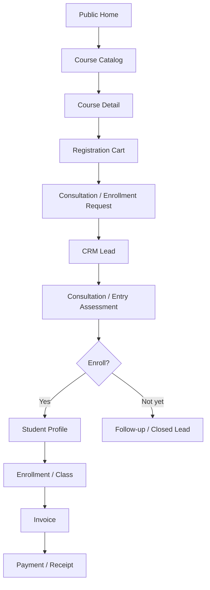
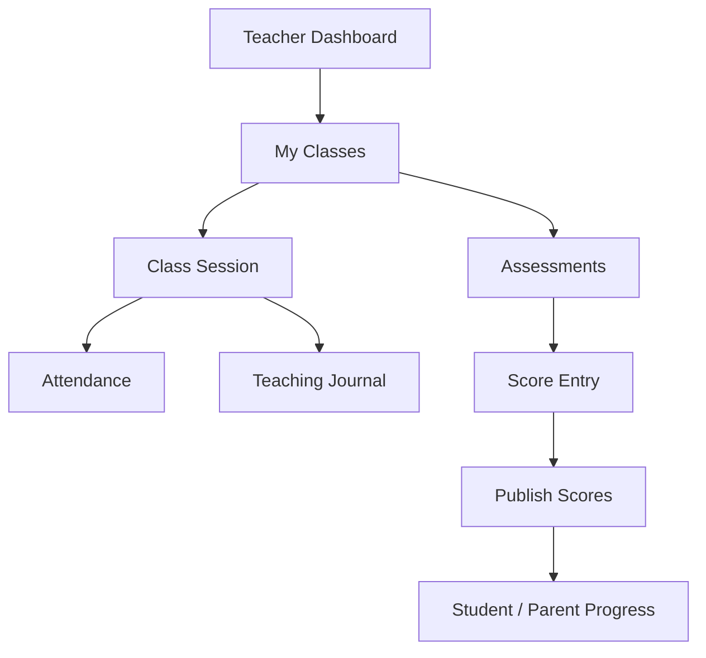
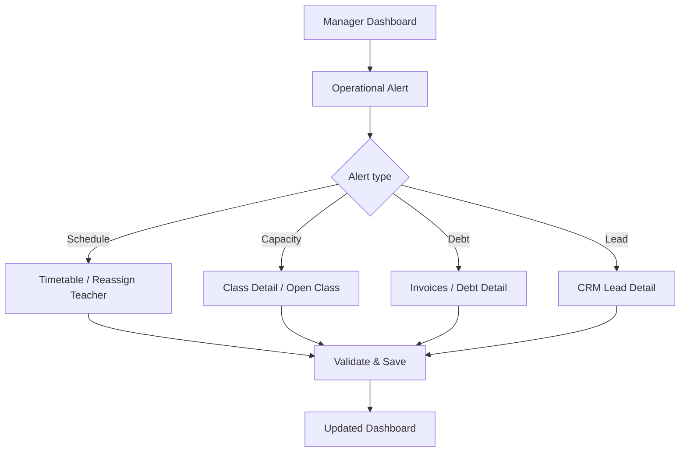

# EduCenter — Design System & UI/UX Specification

> **Document:** `design.md` · **Version:** 1.0 · **Product:** Tutoring & Exam Preparation Management System  
> **Status:** Implementation-ready design specification · **Language:** Vietnamese UI  
> **Reference:** Existing EduCenter HTML mockups supplied by project owner (Dashboard, CRM, Classes, Attendance).  
> **Priority:** Consistent, modern, professional, accessible, functional. **Light mode is default.**

## 0. Purpose and non-negotiable rules

This file is the **single source of truth for UI implementation** across the EduCenter project. Developers and coding agents must read it before creating or modifying JSP/CSS/JS. Follow the existing SRS for business rules and authorization; this document governs presentation, layout, screen behavior and navigation.

**MUST:**
1. Professional enterprise SaaS appearance: calm, precise, uncluttered, high information density without crowding.
2. **Default LIGHT**, even when OS prefers dark. Dark only after explicit user choice; persist choice across navigation/reload.
3. **No emoji as interface icons, no 3D icons, no cartoon/AI-generated icon sets, no meaningless decorations, no flashy gradients.** Use one consistent 18–20px outline icon family (Lucide SVG recommended). Icons are optional, never a replacement for readable labels.
4. **JDK 17, NetBeans 17, Tomcat 10.1, Servlet/JSP, JSTL/EL, SQL Server, JPA/Hibernate**. Do not introduce Spring Boot, React, Vue, Next.js, or Tailwind CDN into the delivered app.
5. All navigation, forms, tables, controls and states must actually work. No dead `href="#"`, fake action buttons or hardcoded production KPIs.
6. All sensitive actions are validated/authorized server-side. JSP renders view only; no SQL/business logic in JSP.
7. Mobile/tablet responsive; no overlapping components or accidental full-page horizontal scroll.
8. Use semantic HTML, keyboard navigation, clear focus rings, sufficient contrast, reduced-motion support.
9. Prefer a consistent shared layout/components over per-page custom styling.
10. **CẤM HARDCODE DỮ LIỆU TRÊN GIAO DIỆN (DỰ ÁN THỰC TẾ):** 100% dữ liệu hiển thị (danh sách khóa học, số lớp đang mở, hồ sơ giáo viên, dropdown môn học, bảng số liệu...) BẮT BUỘC phải được truy vấn động từ CSDL thông qua kiến trúc phân tầng chuẩn (JPA EntityManager -> Repository -> Service -> Controller -> request.setAttribute -> JSP JSTL/EL). Tuyệt đối cấm gõ cứng dòng HTML giả (mock rows), thẻ KPI tĩnh, hoặc tài khoản demo/autofill lên giao diện. Khi CSDL chưa có dữ liệu, bắt buộc hiển thị Empty State chuyên nghiệp có thông báo và nút hành động.

## 1. Visual direction and source reference

**Brand:** EduCenter ERP — tutoring, academic operations and exam preparation. Desired impression: trustworthy education management software, clean administrative tooling, serious enough for staff and approachable for parents/students.

The provided HTML reference shows: a left navigation sidebar, compact topbar with breadcrumb/search/theme/account, KPI cards, teaching schedule, CRM funnel, operational alerts and recent activities; separate CRM, class management and attendance pages. **Preserve its useful information architecture**, but refine visual noise and normalize styles. In particular:
- Retain sidebar section groups and operational dashboard priorities.
- Retain compact metrics, operational schedule, CRM pipeline and actionable alerts.
- Replace arbitrary decorative icons, oversized cards, gratuitous shadows, animated status dots, gradients and inconsistent rounded corners with shared tokens.
- Existing HTML uses Tailwind CDN and Material Symbols; treat this as a **visual prototype only**, not the production technology stack. Convert to local CSS + JSP/JSTL; choose one approved outline SVG icon set.
- Existing reference auto-selects dark based on OS; **override that behavior**: first visit always light.
- Sample dates, names, metrics, version labels and role-switcher from mockup are demo data, not production facts or authorization logic.

### 1.1 UX principles

| Principle | Rule |
|---|---|
| Clarity | Page title states task; one dominant action per screen. |
| Predictability | Same actions, filters, statuses and component placement across modules. |
| Efficiency | Minimize clicks for daily attendance, payment confirmation, and lead follow-up. |
| Context | Show student/class/course identifiers and current status before editing. |
| Safety | Confirm destructive/financial actions; preserve user input after validation errors. |
| Accessibility | Text labels, keyboard access, WCAG AA contrast targets. |
| Data integrity | Never visually claim success until server confirms persistence. |

## 2. Design tokens

### 2.1 Theme colors

| Token | Light (default) | Dark |
|---|---|---|
| `--bg` | `#F8FAFC` | `#0B1120` |
| `--surface` | `#FFFFFF` | `#111827` |
| `--surface-muted` | `#F1F5F9` | `#182234` |
| `--surface-hover` | `#EAF0F8` | `#223047` |
| `--text` | `#0F172A` | `#F1F5F9` |
| `--text-muted` | `#64748B` | `#94A3B8` |
| `--border` | `#E2E8F0` | `#29374B` |
| `--primary` | `#2563EB` | `#60A5FA` |
| `--primary-hover` | `#1D4ED8` | `#93C5FD` |
| `--success` | `#15803D` | `#4ADE80` |
| `--warning` | `#B45309` | `#FBBF24` |
| `--danger` | `#B91C1C` | `#F87171` |
| `--focus` | `#2563EB` | `#93C5FD` |

Use semantic tokens, not hardcoded colors inside JSP. Status badges use low-saturation backgrounds with readable foreground text; never convey meaning only by color. White-on-primary text must remain contrast-safe in each theme (dark primary is best used for text/borders or paired with a darker filled button token).

```css
:root {
  color-scheme: light;
  --bg:#F8FAFC; --surface:#FFFFFF; --surface-muted:#F1F5F9;
  --surface-hover:#EAF0F8; --text:#0F172A; --text-muted:#64748B;
  --border:#E2E8F0; --primary:#2563EB; --primary-hover:#1D4ED8;
  --success:#15803D; --warning:#B45309; --danger:#B91C1C; --focus:#2563EB;
  --button-primary-bg:#2563EB; --button-primary-text:#FFFFFF;
  --radius-sm:6px; --radius-md:8px; --radius-lg:10px;
  --sidebar-width:256px; --header-height:56px;
}
html[data-theme="dark"] {
  color-scheme: dark;
  --bg:#0B1120; --surface:#111827; --surface-muted:#182234;
  --surface-hover:#223047; --text:#F1F5F9; --text-muted:#94A3B8;
  --border:#29374B; --primary:#60A5FA; --primary-hover:#93C5FD;
  --success:#4ADE80; --warning:#FBBF24; --danger:#F87171; --focus:#93C5FD;
  --button-primary-bg:#2563EB; --button-primary-text:#FFFFFF;
}
```

### 2.2 Typography, spacing, radius, elevation

- Font: **Inter**, fallback `system-ui, -apple-system, "Segoe UI", sans-serif`. Serve local/static asset or use safe fallback when offline.
- Body: 14px/20px; dense table metadata 12–13px/18px; labels 13–14px/20px.
- Page heading: 24–28px/32–36px, weight 650–700; section heading 16–18px/24px, weight 600.
- KPI value: 26–32px, tabular numbers; financial values wrap gracefully rather than truncate critical amounts.
- Spacing scale: `4, 8, 12, 16, 24, 32, 40, 48px`. Desktop content padding 24px; mobile 16px; card padding 16–24px.
- Radii: control 6–8px, card 10px, badge 6px; avoid pill-shaped everything.
- Border: 1px semantic border; shadows only for dropdown/dialog/floating layers; no heavy card shadows.
- Motion: 150–200ms for hover/focus/menu, no infinite pulsing or ornamental animation.
- Layout max content width: 1440px (wide operational tables may fill available width).

### 2.3 Icons and imagery

- One outline SVG set (Lucide recommended), 16px inline, 18–20px navigation/actions; stroke ~1.75–2.
- Never use emoji, sticker, colorful icon tiles, AI robot/brain motifs, 3D illustration, meaningless chart art.
- Photos only on public marketing pages when relevant and licensed; internal ERP prioritizes data and text.
- Logo should be a restrained wordmark; no forced slogan or decorative gradient.

## 3. Theme behavior (acceptance-critical)

1. First visit with no saved preference → **light**, regardless of OS theme.
2. Toggle in topbar; optional Settings preference. Store only `'light'` or `'dark'` in `localStorage['educenter-theme']`.
3. Apply theme **in `<head>` before CSS** to avoid flash. Do not overwrite preference on login/logout unless explicitly required.
4. All overlays, scrollbars where styled, form controls, charts, calendars, tooltips and printing must be tested in both themes.
5. Respect `prefers-reduced-motion`; do **not** use `prefers-color-scheme` to choose default theme.
6. If localStorage is unavailable, fall back to light without crashing.

```html
<script>
(function () {
  var theme = 'light';
  try { if (localStorage.getItem('educenter-theme') === 'dark') theme = 'dark'; } catch (e) {}
  document.documentElement.setAttribute('data-theme', theme);
})();
</script>
```

```javascript
function setTheme(theme) {
  const next = theme === 'dark' ? 'dark' : 'light';
  document.documentElement.setAttribute('data-theme', next);
  try { localStorage.setItem('educenter-theme', next); } catch (e) {}
  const button = document.querySelector('[data-theme-toggle]');
  if (button) button.setAttribute('aria-label', next === 'dark' ? 'Chuyển sang giao diện sáng' : 'Chuyển sang giao diện tối');
}
```

## 4. Global shell and responsive layout

### 4.1 Desktop (≥ 1024px)

```text
┌───────────────────┬──────────────────────────────────────────────────────┐
│ EduCenter         │ Breadcrumb / Search       Theme  Alerts  Account    │
│───────────────────┼──────────────────────────────────────────────────────┤
│ Overview          │ Page title                          Primary action │
│ Admissions / CRM  │ Context + filter/action bar                           │
│ Academics         │ ┌──────────────────────────────────────────────────┐ │
│ Teaching          │ │ Main content / tables / charts / forms            │ │
│ Finance           │ └──────────────────────────────────────────────────┘ │
│ Reporting         │                                                      │
│ Settings          │                                                      │
└───────────────────┴──────────────────────────────────────────────────────┘
```

- Sidebar fixed 256px; scrollable inner navigation, not the entire shell. Optional collapsed 72px with accessible labels/tooltips.
- Header 56px high; avoid crowding. Search may become a separate action on narrow widths.
- Content area padded 24px, 16–24px gaps, natural vertical scroll. Use sticky header only when it doesn't obscure content.
- Sidebar active item: subtle tinted background + primary text/indicator, not a full saturated rectangle.
- Navigation groups: **Tổng quan; Tuyển sinh & CRM; Đào tạo & Học vụ; Giảng dạy & Đánh giá; Tài chính; Báo cáo; Hệ thống**.
- Sidebar must be filtered by authenticated permissions; role selector in prototype is **not** a production authorization mechanism.

### 4.2 Tablet (768–1023px)

- Sidebar becomes dismissible drawer; backdrop and close control; focus management on open/close.
- Two-column KPI grid; filters wrap; complex tables scroll inside table container.
- Header shows page context, theme, notification and profile; search can open a modal.

### 4.3 Mobile (< 768px)

- One-column cards and forms; 16px page padding; menu button opens drawer.
- Large data tables: show essential columns + overflow or a purposeful record-card view; never shrink fonts below 12px to fit.
- Primary action stays visible near page header or mobile action region, without covering content.
- Minimum practical tap target 40–44px; dialogs fit viewport; prevent background scroll when drawer/modal open.

## 5. Component UI rules

### 5.1 Page header

Breadcrumb (optional) → page title → one-line contextual description → primary action at right. Do not repeat title in giant decorative banners. On mobile actions wrap beneath title.

### 5.2 Buttons

| Variant | Usage | Rule |
|---|---|---|
| Primary | One dominant action (`Thêm lớp`, `Lưu`, `Ghi danh`) | At most one per local action group |
| Secondary | Secondary safe action (`Xuất báo cáo`) | Neutral surface/border |
| Ghost | Table row/menu actions | Text/icon only, visible focus |
| Danger | Delete/revoke/cancel | Explicit label + confirmation |

Loading disables repeat submission; no success toast before server response. Icon-only buttons require `aria-label` and tooltip.

### 5.3 Forms

- Labels above controls; required marker + clear validation message; help text only when needed.
- Input height ~40px desktop, 44px mobile; focus ring 2px; do not rely on placeholder as label.
- Desktop form width ideally 640–880px; 2 columns for short related fields, 1 column for long content.
- Keep entered values and show server validation after failed submit; confirm navigation away if dirty.
- Currency uses `vi-VN` display but normalized decimal data in backend; dates displayed `dd/MM/yyyy`, stored as proper date/time types.
- Password: reveal toggle, caps lock hint if relevant, no sensitive value echoed in errors.

### 5.4 Data tables

`Title → Search/Filters → Toolbar → Table → Pagination`.

- Header fixed or sticky only inside scrolling table; row height ~48–56px.
- Column order: identity/name → context → status → time/value → actions.
- Sort indicators and accessible labels; server-side filtering/pagination for large datasets.
- Empty state explains next action; distinguish zero results after filters from no records at all.
- Use small neutral status badges; critical status adds clear text.
- Row action menu has View/Edit/Archive according to permission; no clickable row competing with buttons.
- Show total count and current range; preserve filter/sort/page in URL query parameters.

### 5.5 Cards, KPI, charts

- KPI card: short label, value, relevant comparison with explicit period; avoid fake trends.
- Financial card clearly distinguishes **đã thu**, **phải thu**, **còn nợ**; no misleading use of "doanh thu" for unpaid invoices.
- Charts have title, timeframe, units, legend, accessible text/table alternative. Never infer live/real-time status unless data refresh truly supports it.
- No animated pulse on static statuses.

### 5.6 Dialogs, toasts, notifications

- Dialog sizes: 480px confirm, 640–800px medium form, full page for complex workflows.
- Modal traps focus, Escape closes when safe, returns focus to opener; destructive confirmation is explicit.
- Toast: success/error/warning/information; concise message, dismissible, not the sole error channel.
- Never use `alert()` / `confirm()` as the default production interaction.

### 5.7 States for EVERY screen

`loading`, `loaded`, `empty`, `filtered-empty`, `error`, `permission-denied`, `success`, `validation-error`. Design skeletons only where async fetch actually occurs; server-rendered pages can show a stable initial layout without fake spinners.

## 6. Screen inventory and route map

**Routes are proposed logical contracts; reconcile with existing Servlet mappings before implementation.** `GET` renders, `POST` mutates with CSRF protection. JSP files live under `/WEB-INF/views/` and are never direct public URLs.

| ID | Screen | Suggested route | Audience | Key UI |
|---|---|---|---|---|
| PUB-01 | Cổng thông tin gia sư THPT | `/` | Public | Hero THPT, 3 khối lớp, 6 môn học, khóa học nổi bật, đội ngũ giáo viên, tiến độ SaaS, FAQ, CRM Lead form |
| PUB-02 | Danh sách khóa học | `/courses` | Public | Search/filter/sort/pagination |
| PUB-03 | Chi tiết khóa học | `/courses/{id}` | Public | Curriculum, price, timetable, related courses |
| PUB-04 | Danh sách đăng ký | `/registration-cart` | Student/Parent | Selected courses, total, remove |
| PUB-05 | Đăng ký tư vấn | `/consultation` | Public | Lead form, consent, confirmation |
| AUTH-01 | Đăng nhập | `/login` | Public | Email/password, recovery |
| AUTH-02 | Đăng ký | `/register` | Public | Account form |
| AUTH-03 | Quên/đặt lại mật khẩu | `/forgot-password`, `/reset-password` | Public | Secure recovery |
| SYS-01 | Hồ sơ cá nhân | `/profile` | Authenticated | Personal info/password/theme |
| ADM-01 | Dashboard điều hành | `/manager/dashboard` | Manager/Admin | KPIs, schedule, funnel, alerts, activity |
| CRM-01 | Lead list | `/staff/leads` | Staff/Manager | Filters, pipeline, table |
| CRM-02 | Lead detail / tư vấn | `/staff/leads/{id}` | Staff/Manager | Timeline, notes, next action |
| CRM-03 | Thi thử / kiểm tra đầu vào | `/staff/trials` | Staff/Manager | Bookings, outcomes |
| AC-01 | Môn học / khóa học | `/staff/courses` | Staff/Manager | CRUD, status, filters |
| AC-02 | Chi tiết / chỉnh sửa khóa học | `/staff/courses/{id}` | Staff/Manager | Curriculum, fee, classes |
| AC-03 | Lớp học | `/staff/classes` | Staff/Manager | Capacity, teacher, status |
| AC-04 | Chi tiết lớp / danh sách học viên | `/staff/classes/{id}` | Staff/Manager | Tabs, roster, sessions |
| AC-05 | Thời khóa biểu | `/staff/timetable` | Staff/Manager | Week/calendar, conflicts |
| AC-06 | Phòng học | `/staff/rooms` | Staff/Manager | Capacity, availability |
| PPL-01 | Học viên | `/staff/students` | Staff/Manager | List, search, status |
| PPL-02 | Hồ sơ học viên | `/staff/students/{id}` | Staff/Manager | Profile, guardian, progress, debt |
| PPL-03 | Phụ huynh | `/staff/guardians` | Staff/Manager | Links to students |
| PPL-04 | Giáo viên / phân công | `/staff/teachers` | Staff/Manager | Expertise, schedule |
| ENR-01 | Ghi danh / chuyển lớp | `/staff/enrollments` | Staff/Manager | Wizard, capacity, invoice |
| TCH-01 | Dashboard giáo viên | `/teacher/dashboard` | Teacher | Today's lessons, pending tasks |
| TCH-02 | Lớp của tôi | `/teacher/classes` | Teacher | Assigned classes |
| TCH-03 | Điểm danh buổi học | `/teacher/sessions/{id}/attendance` | Teacher | Roster, attendance quick actions |
| TCH-04 | Nhật ký giảng dạy | `/teacher/sessions/{id}/journal` | Teacher | Lesson notes, homework |
| TCH-05 | Bài kiểm tra / nhập điểm | `/teacher/assessments` | Teacher | Assessment, score grid, publish |
| FIN-01 | Hóa đơn / công nợ | `/staff/invoices` | Finance Staff/Manager | Aging, status, balances |
| FIN-02 | Chi tiết hóa đơn | `/staff/invoices/{id}` | Finance Staff/Manager | Items, payment history |
| FIN-03 | Thu học phí / biên lai | `/staff/payments` | Finance Staff/Manager | Payment entry, receipt |
| RPT-01 | Báo cáo / thống kê | `/manager/reports` | Manager/Admin | Date filters, aggregates, export |
| COM-01 | Q&A | `/questions` | All per permission | Ask, answer, moderation status |
| COM-02 | Kiểm duyệt Q&A | `/admin/questions` | Admin/authorized Staff | Review/approve/reject |
| COM-03 | Thông báo | `/notifications` | Authenticated | Inbox, read/unread |
| STU-01 | Dashboard học viên | `/student/dashboard` | Student | Schedule, results, tuition |
| STU-02 | Lịch học / điểm số | `/student/learning` | Student | Tabs, progress |
| PAR-01 | Dashboard phụ huynh | `/parent/dashboard` | Parent | Child switcher, alerts |
| PAR-02 | Chi tiết tiến độ con | `/parent/students/{id}` | Parent | Attendance, grades, invoices |
| SEC-01 | Tài khoản / phân quyền | `/admin/users` | Admin | RBAC CRUD |
| SEC-02 | Cấu hình / nhật ký | `/admin/settings` | Admin | Settings, audit logs |
| ERR-01 | 403 / 404 / 500 | `/error/*` | All | Recovery, safe navigation |

### 6.1 Navigation by role

- **Guest:** Home, Courses, Course Detail, Consultation, Login/Register.
- **Admin:** Dashboard, user/role management, Q&A moderation, settings/audit; additional modules only if granted.
- **Manager:** Dashboard, CRM, academic operations, finance, reports, Q&A.
- **Staff:** CRM, students/guardians, teachers, courses/classes, schedule, enrollment, authorized finance, Q&A.
- **Teacher:** My Classes, Sessions, Attendance, Teaching Journal, Assessments, Profile, Q&A.
- **Student:** Dashboard, Courses/Registration, My Learning, Tuition, Notifications, Q&A.
- **Parent:** Dashboard, Child Switcher, Child Progress, Tuition, Notifications, Q&A.

### 6.2 Main screen flows







### 6.3 Screen transition rules

- After create → show success + open created record or return to list with preserved filters.
- After edit → stay on detail, show updated data; never silently discard edits.
- After delete/archive → confirm, return to list, maintain page if valid.
- After unauthorized access → 403 page, no sensitive data leak.
- After expired session → login, optionally restore safe destination after reauthentication.
- Breadcrumb always points to actual accessible parent routes; no placeholder links.

## 7. Page-by-page detailed UI requirements

### 7.0 PUB-01 — Cổng thông tin gia sư & Bổ trợ THPT (Landing Portal)

**URL:** `/` hoặc `/index` · **Đối tượng:** Khách vãng lai, Học sinh THPT Lớp 10–12, Phụ huynh học sinh.  
**Nguyên tắc cốt lõi:** 100% dữ liệu hiển thị (Số lớp đang mở, Khóa học nổi bật, Hồ sơ giáo viên, Danh mục môn học) phải được truy vấn động từ CSDL thông qua `LandingService` -> `LandingServlet` -> `request.setAttribute("portalData", ...)`. Tuyệt đối CẤM hardcode dữ liệu giả.

#### Bố cục 11 phân khu chức năng (Layout Architecture):
1. **Phân khu 01: Topbar Navbar:**
   - Logo thương hiệu: Chữ `EduCenter` kèm huy hiệu `THPT Tutoring` (nền `var(--primary-subtle)`, chữ `var(--primary)`).
   - Menu điều hướng: Trang chủ, Chương trình gia sư, Môn học, Đội ngũ giáo viên, Quy trình học, Tư vấn tuyển sinh.
   - Nút chuyển đổi giao diện Sáng / Tối (`#theme-toggle-btn`), nút Đăng nhập (`/login`), và nút CTA Đăng ký tư vấn.
2. **Phân khu 02: Hero Section & Thẻ Tiến Độ SaaS:**
   - Huy hiệu pill: "Chuyên biệt Gia sư & Bổ trợ Kiến thức THPT" có chấm pulsing màu primary.
   - Tiêu đề H1: "Gia sư chất lượng cho học sinh lớp 10, 11 và 12".
   - 2 Nút CTA: "Tìm gia sư phù hợp" và "Đăng ký tư vấn miễn phí".
   - Thanh lọc nhanh theo khối lớp: Hiển thị bộ đếm số lớp học đang mở thực tế từ CSDL (`portalData.openClassesCount`), các nút chip lọc Lớp 10, Lớp 11, Lớp 12 kèm số lượng lớp tương ứng.
   - Thẻ hiển thị tiến độ học tập (SaaS Progress Card): Trực quan hóa mục tiêu điểm số (6.5 -> 8.5+), biểu đồ cột Sparkline 6 kỳ kiểm tra (5.8 đến 8.6), 3 chỉ số vận hành (Chuyên cần 96.4%, Đã học 16/24 buổi, BTVN 100%), chữ ký giáo viên phụ trách.
3. **Phân khu 03: Chương trình theo 3 Khối lớp (3 Focused Grade Cards):**
   - Lớp 10: Thích nghi & Nền tảng (Xây dựng nền tảng vững chắc, môn bồi dưỡng trọng điểm).
   - Lớp 11: Tăng tốc điểm số & Bứt phá năng lực (Lượng giác, Hình học không gian, nâng cao).
   - Lớp 12 (Thẻ trọng điểm viền Primary): Luyện đề & Về đích (Chinh phục Tốt nghiệp THPT & ĐGNL).
4. **Phân khu 04: Gia sư theo Bộ môn chuyên ngành (Subjects Grid):**
   - Render động từ danh sách môn học trong CSDL (`portalData.subjects`).
   - 6 Môn trọng điểm: Toán học (`MATH`), Vật lý (`PHYS`), Hóa học (`CHEM`), Tiếng Anh (`ENG`), Ngữ văn (`LIT`), Sinh học (`BIO`).
   - Hiển thị icon outline SVG tương ứng từng môn, số lượng chương trình/khóa học đang mở từ CSDL.
5. **Phân khu 05: Khóa học & Lớp học gia sư nổi bật (Featured Courses):**
   - Render động từ CSDL (`portalData.featuredCourses`).
   - Thẻ khóa học bao gồm: Loại hình (Gia sư 1 kèm 1 / Nhóm nhỏ tối đa X học viên), Khối lớp, Trạng thái (Đang tuyển sinh), Tên khóa học, Thời lượng (số buổi/tuần), Lịch học cụ thể, Giáo viên phụ trách kèm học vị, Học phí niêm yết định dạng tiền tệ VNĐ (`vi-VN`), Cam kết điểm số và Nút đăng ký giữ chỗ.
6. **Phân khu 06: Cam kết Năng lực Học thuật (6 Value Pillars):**
   - 6 Trụ cột: Lộ trình cá nhân hóa, Đội ngũ sư phạm chuẩn hóa, Minh bạch nhật ký & chuyên cần, Quản lý lịch học khoa học, Cổng Phụ Huynh (Parent Portal), Đánh giá năng lực bài bản.
7. **Phân khu 07: Ban Cố Vấn Học Thuật & Đội ngũ Giáo viên nòng cốt:**
   - Render động từ CSDL (`portalData.facultyTeachers`).
   - Mỗi giáo viên hiển thị: Ảnh đại diện/icon outline, huy hiệu kinh nghiệm (vd: 10 năm KN, IELTS 8.5), Họ tên, Chức vụ/Học vị, Tiểu sử tóm tắt và Phân công giảng dạy theo khối lớp.
8. **Phân khu 08: Quy trình 4 bước bắt đầu học (Timeline Stepper):**
   - 01. Chọn khối lớp & Môn học -> 02. Gửi thông tin nhu cầu -> 03. Kiểm tra đầu vào miễn phí -> 04. Xếp lịch & Khởi động.
9. **Phân khu 09: Cổng theo dõi tiến độ Phụ Huynh & Học Sinh (Live Showcase):**
   - Giới thiệu 3 tiện ích nổi bật: Điểm danh tức thì, Biểu đồ điểm số, Hóa đơn điện tử minh bạch.
   - Khung giao diện giả lập trình duyệt (Browser window) hiển thị bản xem trước Cổng Phụ Huynh: Điểm trung bình, Số buổi tham gia, Trạng thái học phí, và Bảng trích xuất 3 buổi học gần nhất.
10. **Phân khu 10: Câu hỏi thường gặp (FAQ Accordion):**
    - 6 Câu hỏi giải đáp thắc mắc then chốt về khối lớp THPT, hình thức 1 kèm 1, Cổng phụ huynh, kiểm tra đầu vào, phương thức học phí và chính sách đổi lịch/học bù.
11. **Phân khu 11: Biểu mẫu Đăng ký Tư vấn Tuyển sinh (CRM Lead Generation):**
    - Tích hợp biểu mẫu form gửi dữ liệu thực tế về Servlet (`POST /dang-ky-tu-van`):
      - Họ tên Phụ huynh / Học sinh (bắt buộc)
      - Số điện thoại (bắt buộc, regex di động Việt Nam `^(0[3|5|7|8|9])+([0-9]{8})$`)
      - Khối lớp học (10, 11, 12)
      - Môn học trọng tâm
      - Hình thức học (Lớp nhóm nhỏ, Gia sư 1-1)
      - Mục tiêu / Tình trạng học tập
      - Mã bảo vệ CSRF token (`sessionScope.csrfToken`)
    - Xử lý lưu trực tiếp vào bảng `dbo.Leads` trong CSDL với nguồn `WEBSITE` và trạng thái `NEW`. Phản hồi thông báo mã hồ sơ CRM thành công cho người dùng.
12. **Chân trang hệ thống (Enterprise Footer):**
    - Trụ sở: Tòa EduCenter Tower, Cầu Giấy, Hà Nội; Hotline: 1900 6868; Email: banquantri@educenter.vn; Các cột liên kết chương trình THPT, Hỗ trợ & Quy định, Bản quyền.

---

### 7.1 ADM-01 — Executive dashboard (based on supplied reference)

**Layout:** Header/title/date filter; four KPIs; 7/5 split schedule + CRM funnel; 7/5 split alerts + recent activity. Stack at tablet/mobile.

- KPI 1: active students, comparison period, link to students.
- KPI 2: active classes and room utilization; show denominator and definition.
- KPI 3: tuition actually collected (VND) and invoiced amount; date period explicit.
- KPI 4: outstanding debt, overdue count, link to invoices.
- Schedule: today’s sessions sorted by start time; teacher, room, capacity, attendance state; actions link to valid session detail.
- CRM funnel: leads by stage, stage conversion percentages with documented denominator; drill-down to CRM filters.
- Alerts: missing teacher, full classes, pending approvals, overdue fees; severity labels and contextual actions.
- Activity feed: actor, event, time; not labelled “real-time” unless genuinely updated live.
- Date filter Today / Week / Month / Quarter; server-provided aggregates; export only if implemented.
- **Avoid:** pulse decoration, fabricated percentage, truncated money, decorative status chips.

### 7.2 CRM-01 / CRM-02 — Lead management

- Overview: new leads, contacted, scheduled assessment, enrolled, conversion rate with timeframe.
- Filter bar: search name/phone, source, status, owner, created range; Reset and count.
- Table: lead ID, contact, interest subject/grade, source, owner, status, last contact, next follow-up, actions.
- Lead detail: left contact summary; right consultation timeline, trial assessment, notes, next task; conversion action.
- Confirm enrollment only after student identity, class capacity and invoice preview are validated.
- Avoid displaying full phone numbers to roles without permission.

### 7.3 AC-01 to AC-06 — Courses, classes and timetable

- Course list: subject, grade, target exam, fee, sessions, active state, class count; filter/search.
- Class list: code, course, teacher, room, capacity, enrollment, schedule, status; clear full/available badge.
- Class detail tabs: Overview, Students, Sessions, Attendance Summary, Assessments, History.
- Timetable: week view + accessible list alternative; day/time, room, teacher, status. Conflicts surfaced before save.
- Create/edit class: step or sectioned form for course → teacher → room → recurrence → capacity → review.
- Cancel/reschedule requires reason and notifies impacted users where supported.

### 7.4 TCH-03 / TCH-04 — Attendance and teaching journal

- Session header: class code, subject, date/time, teacher, room, enrolled count.
- Attendance table: student ID/name, status segmented choice (Present / Excused / Unexcused / Late), notes.
- Quick action “Mark all present” requires review before final submission.
- Show progress “x/y marked”, unsaved changes, save draft and finalize if supported by backend.
- Journal: lesson content, covered topics, homework, teacher remarks; linked to session.
- Parent sees only published/authorized attendance information.

### 7.5 TCH-05 — Assessments and grades

- List assessments by class, date, type, max score, publish state.
- Score entry grid supports keyboard tab, per-row validation, decimal format, unsaved warning.
- Separate Save Draft and Publish Results; confirmation before publishing.
- Progress chart labels each assessment/date; don't imply causality from trends.

### 7.6 FIN-01 to FIN-03 — Tuition and receivables

- Invoice list: invoice code, student, class, due date, total, paid, outstanding, status.
- Detail: line items, discounts, payment timeline, receipts, audit metadata.
- Payment form: invoice, payment date, method, amount, reference, note; preview outstanding balance.
- Block negative/over-limit payments unless approved business workflow exists.
- Reversal/correction must be auditable; never silently delete confirmed transactions.
- Export/print receipt layout is clean, high contrast, print-friendly.

### 7.7 Student and parent portals

- Student: next lesson, classes, grades, attendance, fees, Q&A; concise navigation.
- Parent: verified child switcher, per-child dashboard, schedule, grades, attendance, invoices; never cross-link to unrelated student records.
- Prioritize mobile readability, plain Vietnamese, transparent statuses and contact actions.

### 7.8 Q&A and moderation

- Questions list with category, author display policy, status, response count.
- Ask question form; teacher/staff response; moderation queue with Approve/Reject + reason.
- Publicly visible content only when approved; draft/rejected content shown only to authorized users.

### 7.9 Authentication and errors

- Clean split or centered auth panel; no stock illustration necessary.
- Friendly, precise error messages; no account existence leak on password reset.
- 403, 404, 500 screens use shared brand and clear recovery action.

## 8. JSP, JSTL and Servlet implementation rules

### 8.1 Production file layout (NetBeans web application)

```text
web/
├── assets/
│   ├── css/
│   │   ├── tokens.css
│   │   ├── base.css
│   │   ├── layout.css
│   │   ├── components.css
│   │   └── pages.css
│   ├── js/
│   │   ├── theme.js
│   │   ├── sidebar.js
│   │   ├── forms.js
│   │   └── tables.js
│   ├── icons/             # approved local SVG icons
│   └── fonts/             # optional locally licensed fonts
└── WEB-INF/
    └── views/
        ├── common/
        │   ├── head.jspf
        │   ├── sidebar.jspf
        │   ├── header.jspf
        │   ├── alerts.jspf
        │   └── footer.jspf
        ├── public/
        ├── auth/
        ├── manager/
        ├── staff/
        ├── teacher/
        ├── student/
        ├── parent/
        └── admin/
```

### 8.2 Java/JSP conventions

- Jakarta namespace compatible with **Tomcat 10.1**; use Jakarta JSTL 3.x libraries compatible with Servlet 6/JSP 3.1.
- JSTL core URI: `jakarta.tags.core`; formatting URI: `jakarta.tags.fmt` (when matching Jakarta Tags 3.x dependencies).
- Controllers receive requests, validate and call service; JPA repository handles persistence; controller sets request attributes and forwards to JSP.
- Use `<c:out>` or escaped EL output for user-provided text. Do not inject untrusted HTML via raw output.
- Never authorize with CSS/hidden menu only: use servlet filter/security layer and record-level permission checks.
- Use `${pageContext.request.contextPath}` for application-relative assets and routes; use `<c:url>` when constructing links with parameters.
- All mutating requests use POST (or appropriate method with secure handling), CSRF token and POST/Redirect/GET on success.
- Render server-side pagination/filter state consistently with query parameters.
- Use `BigDecimal` in Java for money and formatted Vietnamese currency in view.
- No `scriptlet` business logic, SQL, JPA EntityManager calls or passwords in JSP.

```jsp
<%@ taglib prefix="c" uri="jakarta.tags.core" %>
<%@ taglib prefix="fmt" uri="jakarta.tags.fmt" %>
<h1><c:out value="${pageTitle}" /></h1>
<c:choose>
  <c:when test="${empty courses}">
    <p class="empty-state">Không tìm thấy khóa học phù hợp.</p>
  </c:when>
  <c:otherwise>
    <c:forEach var="course" items="${courses}">
      <article class="course-row">
        <h2><c:out value="${course.name}" /></h2>
        <a href="<c:url value='/courses/${course.id}' />">Xem chi tiết</a>
      </article>
    </c:forEach>
  </c:otherwise>
</c:choose>
```

**Note:** Depending on project routing, build dynamic links with `<c:url>` and `<c:param>` or an appropriately encoded path segment; never concatenate untrusted path fragments.

### 8.3 Shared layout contract

Each JSP view provides `pageTitle`, `activeNav`, `breadcrumbs`, `userRole`, `content` (or equivalent layout composition). Common fragments own the shell; individual pages must not duplicate `<html>`, `<head>`, sidebar or theme logic. Do not let a role-switch dropdown in demo HTML alter server permissions.

## 9. Interaction and validation rules

| Interaction | Required behavior |
|---|---|
| Search | Debounced optional; Enter submits; clear resets; URL reflects state |
| Filter | Visible active filters; reset; preserves sort/page where meaningful |
| Pagination | Server-side for large sets; shows current range and total |
| Save | Client hints + server validation; prevent double-submit |
| Delete/archive | Permission check, explicit confirmation, soft-delete where required |
| Session timeout | Clear login redirect; don't expose stale sensitive data |
| Theme toggle | Works across every JSP route; no flash; default light |
| Notifications | Read/unread state, accessible open/close |
| Keyboard | Tab order, Enter/Space activation, Escape dialogs, visible focus |
| Error | Specific, actionable, non-sensitive message; keep input |
| Print | Hide navigation/actions; legible invoice/receipt |

## 10. Accessibility and performance

- Aim WCAG 2.2 AA: text contrast ≥4.5:1 for normal text, ≥3:1 for large text and UI boundaries where applicable.
- Form labels tied with `for`/`id`; validation connected with `aria-describedby`; `aria-invalid` on error.
- Navigation uses `<nav>`, `<main>`, `<header>` landmarks; one page `<h1>`.
- SVG icons decorative use `aria-hidden="true"`; icon-only actions need accessible name.
- Use `:focus-visible` with visible outline; do not globally remove outlines.
- Dialog keyboard focus management; mobile drawer keyboard access; skip-to-content link.
- Honor `prefers-reduced-motion`; avoid pulsing/blinking badges.
- Keep CSS/JS local and cacheable; defer noncritical scripts; avoid large frameworks for basic interactions.
- No layout shifts caused by font load, cards or loading states. Avoid giant images on ERP pages.

## 11. UI review and acceptance checklist

### Global
- [ ] Default first visit is light even on dark OS.
- [ ] User-chosen dark/light persists across reload, login and navigation.
- [ ] No theme flash; no unreadable components in either theme.
- [ ] No emoji, AI-style 3D icons, cartoon art, random gradients or gratuitous animation.
- [ ] Same sidebar, topbar, typography, spacing, buttons, tables and statuses across pages.
- [ ] Navigation filtered by role **and** secured on server.
- [ ] No dead links, placeholder buttons or fake live metrics.
- [ ] Responsive at 360, 768, 1024, 1440px; no overlaps/overflow.

### Functional
- [ ] Search/filter/sort/pagination function and retain state.
- [ ] CRUD forms validate both client/server, preserve input on errors.
- [ ] Attendance, grades, enrollments and payments honor SRS business rules.
- [ ] Q&A moderation works with correct visibility.
- [ ] Parent cannot access unrelated student's data.
- [ ] Loading/empty/error/permission states exist where relevant.
- [ ] Financial totals reconcile with backend, never hardcoded.

### Engineering
- [ ] JDK17 / NetBeans17 / Tomcat10.1 deployment succeeds.
- [ ] JSP + Jakarta JSTL/EL used correctly; Servlet MVC separation maintained.
- [ ] SQL Server accessed via JPA/Hibernate (not raw JDBC persistence).
- [ ] No Tailwind CDN, React/Vue/Next, Spring Boot or duplicate UI frameworks.
- [ ] Keyboard and screen-reader basics pass manual review.
- [ ] Reusable components and tokens documented; no repeated inline styling.

## 12. Recommended delivery order (3 developers)

| Phase | Deliverable | Owner |
|---|---|---|
| 1 | Shared tokens, themes, sidebar/header, component library | Shared foundation; one integrator |
| 2 | Public pages, CRM, student/parent views, Q&A | Member 02 |
| 3 | Courses, classes, timetable, attendance, assessments, teacher views | Member 01 |
| 4 | Finance, reports, admin/security screens, dashboard | Member 03 |
| 5 | Cross-role flow testing, responsive, accessibility, dark-mode audit | All members |

**Definition of Done per screen:** valid Servlet route + JSP render + authorization + actual data/state + responsive layout + light/dark support + validation + working navigation + tested empty/error state. Do not mark a mockup as complete implementation.

---

## 13. Instruction for coding agents

Read `design.md` and the project's SRS before changing UI. First inventory existing Servlet routes/JSPs/assets. Preserve working code. Implement design tokens and shell before individual screens. Work by feature module; validate each screen against its route, role, data contract, responsive states and light/dark behavior. Do not add decorative AI visuals. When an SRS requirement or backend contract is missing, record the gap instead of inventing production functionality.
