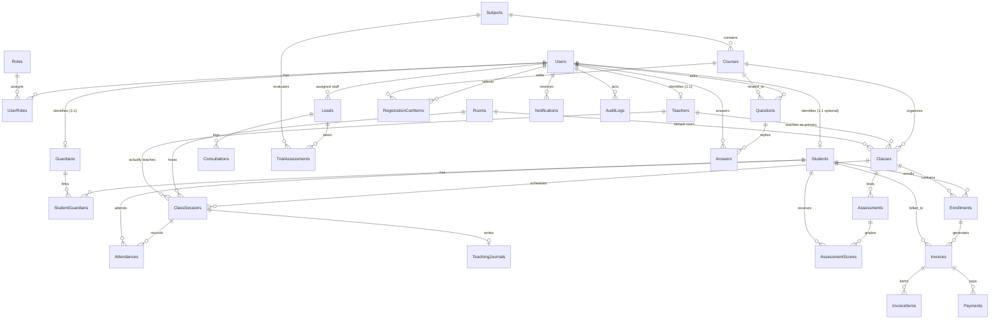

# TÀI LIỆU THIẾT KẾ CƠ SỞ DỮ LIỆU EDUCENTER (SQL SERVER)
**Dự án:** EduCenter – Tutoring & Exam Preparation Management System  
**Hệ Quản Trị CSDL:** Microsoft SQL Server (2019 / 2022)  
**Tương thích ORM:** Jakarta Persistence (JPA 3.1) + Hibernate ORM (Tomcat 10.1, Java 17)  
**Phiên bản tài liệu:** 1.1.0 | **Ngày lập:** 2026-10-22  
**Quy chuẩn áp dụng:** SRS v1.1, BR01–BR20, Project Constitution  

---

## I. TỔNG QUAN KIẾN TRÚC CƠ SỞ DỮ LIỆU

### 1. Nguyên Tắc Thiết Kế Cho Microsoft SQL Server
1. **Kiểu dữ liệu chuẩn hóa:**
   * **Khóa chính:** `BIGINT IDENTITY(1,1)` đảm bảo hiệu năng cao, tự tăng và tương thích trực tiếp với Java `Long` + `@GeneratedValue(strategy = GenerationType.IDENTITY)`. Bảng phân loại nhỏ (`Roles`) dùng `INT IDENTITY(1,1)`.
   * **Văn bản Unicode:** Mọi trường hỗ trợ tiếng Việt (Họ tên, Địa chỉ, Ghi chú, Tiêu đề, Nội dung) dùng `NVARCHAR(n)` hoặc `NVARCHAR(MAX)` với Collation tiếng Việt khuyến nghị `SQL_Latin1_General_CP1_CI_AS` hoặc `Vietnamese_CI_AS`.
   * **Mã & Trạng thái ASCII:** Mã đối tượng (`code`), email, số điện thoại, trạng thái (`status`, enum) dùng `VARCHAR(n)` tiết kiệm bộ nhớ.
   * **Tài chính & Tiền tệ (SEC-03):** Toàn bộ học phí, thanh toán, giảm giá dùng `DECIMAL(18, 2)` (tương ứng `java.math.BigDecimal`), tuyệt đối **KHÔNG** dùng `FLOAT`/`REAL`.
   * **Ngày & Giờ:** Phân tách rõ ràng:
     * Ngày sinh, ngày bắt đầu, ngày kết thúc, ngày thi: dùng `DATE` (`java.time.LocalDate`).
     * Khung giờ ca học: dùng `TIME(0)` (`java.time.LocalTime`).
     * Mốc thời gian giao dịch/hệ thống: dùng `DATETIME2(0)` (`java.time.LocalDateTime`), mặc định `DEFAULT GETDATE()`.
   * **Logic nhị phân:** `BIT` (0, 1) tương ứng `Boolean` (`is_primary`, `is_read`, `is_accepted`, `is_featured`).
2. **Toàn vẹn dữ liệu & Phòng tránh lỗi đệ quy Foreign Key (SQL Server Error 1785):**
   * SQL Server không cho phép nhiều đường dẫn `ON DELETE CASCADE` dẫn đến cùng một bảng đích (gây lỗi cycle/multiple cascade paths).
   * **Giải pháp:** Mọi quan hệ khóa ngoại (Foreign Key) được thiết lập với `ON DELETE NO ACTION` / `ON UPDATE NO ACTION`. Logic xóa được xử lý bằng **Soft Delete** (`status = 'DEACTIVATED' / 'CANCELLED'`) tuân thủ nghiêm ngặt **BR16** và **Article 2 SEC-03**.
3. **Chỉ mục lọc độc quyền SQL Server (Filtered Unique Index):**
   * **BR03 (Chống ghi danh trùng khi bản ghi cũ còn hiệu lực):** Áp dụng chỉ mục có điều kiện:
     ```sql
     CREATE UNIQUE NONCLUSTERED INDEX UQ_Enrollment_Active 
     ON Enrollments(student_id, class_id) 
     WHERE status = 'ACTIVE';
     ```
4. **Kiểm soát đồng thời (Optimistic Locking):**
   * Các bảng nhạy cảm với tranh chấp như `Classes` (sĩ số BR04) và `Invoices` (thanh toán đồng thời) được bổ sung cột `version BIGINT DEFAULT 0` tương thích chuẩn `@Version` của JPA Hibernate.

---

## II. SƠ ĐỒ QUAN HỆ THỰC THỂ TỔNG THỂ (MERMAID ERD)



---

## III. TỪ ĐIỂN DỮ LIỆU CHI TIẾT (30 BẢNG THEO SRS VII.1)

### PHÂN HỆ 1: TÀI KHOẢN & PHÂN QUYỀN (IDENTITY & RBAC)

#### 1. Bảng `Roles` (Vai trò người dùng)
*Quản lý 5 vai trò chuẩn trong hệ thống (MVP gộp Admin & Manager): `ADMIN`, `STAFF`, `TEACHER`, `STUDENT`, `PARENT`.*

| Tên Cột | Kiểu Dữ Liệu | Ràng Buộc | Mô Tả |
|---|---|---|---|
| `id` | `INT IDENTITY(1,1)` | PK | Mã định danh vai trò |
| `code` | `VARCHAR(50)` | NOT NULL, UNIQUE | Mã vai trò (`ADMIN`, `STAFF`, `TEACHER`, `STUDENT`, `PARENT`) |
| `name` | `NVARCHAR(100)` | NOT NULL | Tên hiển thị (Quản trị viên & Quản lý, Nhân viên, Giáo viên, ...) |
| `description` | `NVARCHAR(255)` | NULL | Mô tả quyền hạn vai trò |
| `created_at` | `DATETIME2(0)` | NOT NULL, DEFAULT GETDATE() | Thời điểm tạo |

#### 2. Bảng `Users` (Người dùng hệ thống)
*Lưu trữ định danh đăng nhập, thông tin xác thực băm BCrypt, trạng thái hoạt động.*

| Tên Cột | Kiểu Dữ Liệu | Ràng Buộc | Mô Tả |
|---|---|---|---|
| `id` | `BIGINT IDENTITY(1,1)` | PK | Mã định danh người dùng |
| `email` | `VARCHAR(255)` | NOT NULL, UNIQUE | Email đăng nhập duy nhất (**BR01**), chữ thường |
| `password_hash` | `VARCHAR(255)` | NOT NULL | Mật khẩu băm an toàn bằng BCrypt (cost >= 10, **SEC-01**) |
| `full_name` | `NVARCHAR(150)` | NOT NULL | Họ và tên đầy đủ |
| `phone` | `VARCHAR(20)` | NULL | Số điện thoại liên hệ |
| `avatar_url` | `NVARCHAR(500)` | NULL | Đường dẫn ảnh đại diện |
| `status` | `VARCHAR(20)` | NOT NULL, DEFAULT 'ACTIVE' | Trạng thái: `ACTIVE`, `INACTIVE`, `LOCKED` |
| `created_at` | `DATETIME2(0)` | NOT NULL, DEFAULT GETDATE() | Thời điểm tạo tài khoản |
| `updated_at` | `DATETIME2(0)` | NOT NULL, DEFAULT GETDATE() | Thời điểm cập nhật hồ sơ gần nhất |

#### 3. Bảng `UserRoles` (Bảng liên kết Người dùng - Vai trò)
*Hỗ trợ một người dùng có thể đảm nhận nhiều vai trò (ví dụ: vừa là Staff vừa là Teacher).*

| Tên Cột | Kiểu Dữ Liệu | Ràng Buộc | Mô Tả |
|---|---|---|---|
| `user_id` | `BIGINT` | PK, FK -> `Users(id)` | Khóa ngoại người dùng |
| `role_id` | `INT` | PK, FK -> `Roles(id)` | Khóa ngoại vai trò |
| `assigned_at` | `DATETIME2(0)` | NOT NULL, DEFAULT GETDATE() | Thời điểm gán vai trò |

---

### PHÂN HỆ 2: HỒ SƠ CON NGƯỜI & QUAN HỆ (PEOPLE & RELATIONSHIPS)

#### 4. Bảng `Teachers` (Hồ sơ Giáo viên / Gia sư)
*Mở rộng thông tin học hàm, học vị, chuyên môn giảng dạy.*

| Tên Cột | Kiểu Dữ Liệu | Ràng Buộc | Mô Tả |
|---|---|---|---|
| `id` | `BIGINT IDENTITY(1,1)` | PK | Mã hồ sơ giáo viên |
| `user_id` | `BIGINT` | NOT NULL, UNIQUE, FK -> `Users(id)` | Liên kết 1:1 với tài khoản đăng nhập |
| `full_name` | `NVARCHAR(150)` | NOT NULL | Họ tên giáo viên |
| `phone` | `VARCHAR(20)` | NULL | Số điện thoại |
| `email` | `VARCHAR(255)` | NULL | Email liên hệ công việc |
| `specialization` | `NVARCHAR(255)` | NULL | Chuyên môn (Toán 12, Luyện thi Chuyên Lý, ...) |
| `degree` | `NVARCHAR(100)` | NULL | Bằng cấp (Cử nhân Sư phạm, Thạc sĩ, ...) |
| `bio` | `NVARCHAR(MAX)` | NULL | Giới thiệu kinh nghiệm, thành tích học sinh |
| `hourly_rate` | `DECIMAL(18,2)` | NOT NULL, DEFAULT 0.00 | Mức thù lao theo giờ tham khảo |
| `status` | `VARCHAR(20)` | NOT NULL, DEFAULT 'ACTIVE' | Trạng thái: `ACTIVE`, `INACTIVE`, `ON_LEAVE` |
| `created_at` | `DATETIME2(0)` | NOT NULL, DEFAULT GETDATE() | Thời điểm tạo hồ sơ |
| `updated_at` | `DATETIME2(0)` | NOT NULL, DEFAULT GETDATE() | Thời điểm cập nhật |

#### 5. Bảng `Students` (Hồ sơ Học viên)
*Quản lý thông tin học sinh từ lớp 6 đến lớp 12, mục tiêu điểm số.*

| Tên Cột | Kiểu Dữ Liệu | Ràng Buộc | Mô Tả |
|---|---|---|---|
| `id` | `BIGINT IDENTITY(1,1)` | PK | Mã hồ sơ học viên |
| `user_id` | `BIGINT` | NULL, UNIQUE, FK -> `Users(id)` | Tài khoản đăng nhập (NULL nếu học sinh chưa có tài khoản riêng) |
| `full_name` | `NVARCHAR(150)` | NOT NULL | Họ và tên học sinh |
| `dob` | `DATE` | NULL | Ngày sinh |
| `gender` | `VARCHAR(10)` | NULL | Giới tính (`MALE`, `FEMALE`, `OTHER`) |
| `phone` | `VARCHAR(20)` | NULL | Số điện thoại học sinh |
| `email` | `VARCHAR(255)` | NULL | Email học sinh |
| `school` | `NVARCHAR(255)` | NULL | Trường THCS / THPT đang theo học |
| `grade_level` | `INT` | NOT NULL, CHECK (6-12) | Khối lớp hiện tại (6 đến 12) |
| `target_goal` | `NVARCHAR(500)` | NULL | Mục tiêu (Đỗ Chuyên Sư phạm, ĐH Bách Khoa, ...) |
| `status` | `VARCHAR(20)` | NOT NULL, DEFAULT 'STUDYING' | Trạng thái: `STUDYING`, `RESERVED`, `DROPPED`, `GRADUATED` |
| `created_at` | `DATETIME2(0)` | NOT NULL, DEFAULT GETDATE() | Thời điểm tạo |
| `updated_at` | `DATETIME2(0)` | NOT NULL, DEFAULT GETDATE() | Thời điểm cập nhật |

#### 6. Bảng `Guardians` (Hồ sơ Phụ huynh / Người giám hộ)
*Quản lý phụ huynh học sinh để nhận thông báo, theo dõi chuyên cần và đóng học phí.*

| Tên Cột | Kiểu Dữ Liệu | Ràng Buộc | Mô Tả |
|---|---|---|---|
| `id` | `BIGINT IDENTITY(1,1)` | PK | Mã hồ sơ phụ huynh |
| `user_id` | `BIGINT` | NOT NULL, UNIQUE, FK -> `Users(id)` | Liên kết tài khoản đăng nhập cổng phụ huynh |
| `full_name` | `NVARCHAR(150)` | NOT NULL | Họ tên phụ huynh |
| `phone` | `VARCHAR(20)` | NOT NULL | Số điện thoại chính để liên lạc/Zalo |
| `email` | `VARCHAR(255)` | NULL | Email nhận báo cáo học tập |
| `occupation` | `NVARCHAR(150)` | NULL | Nghề nghiệp |
| `address` | `NVARCHAR(255)` | NULL | Địa chỉ cư trú gia đình |
| `status` | `VARCHAR(20)` | NOT NULL, DEFAULT 'ACTIVE' | Trạng thái: `ACTIVE`, `INACTIVE` |
| `created_at` | `DATETIME2(0)` | NOT NULL, DEFAULT GETDATE() | Ngày tạo hồ sơ |
| `updated_at` | `DATETIME2(0)` | NOT NULL, DEFAULT GETDATE() | Ngày cập nhật |

#### 7. Bảng `StudentGuardians` (Liên kết Học viên - Người giám hộ)
*Đáp ứng yêu cầu: một phụ huynh có thể có nhiều con, một học sinh có thể có bố và mẹ cùng giám hộ.*

| Tên Cột | Kiểu Dữ Liệu | Ràng Buộc | Mô Tả |
|---|---|---|---|
| `id` | `BIGINT IDENTITY(1,1)` | PK | Mã bản ghi liên kết |
| `student_id` | `BIGINT` | NOT NULL, FK -> `Students(id)` | Khóa ngoại học viên |
| `guardian_id` | `BIGINT` | NOT NULL, FK -> `Guardians(id)` | Khóa ngoại phụ huynh |
| `relationship` | `NVARCHAR(50)` | NOT NULL | Mối quan hệ: `Bố`, `Mẹ`, `Người giám hộ` |
| `is_primary` | `BIT` | NOT NULL, DEFAULT 1 | Người nhận thông báo chính (1: Có, 0: Không) |
| `verified_at` | `DATETIME2(0)` | NULL | Thời điểm nhân viên xác thực quan hệ (**BR15**) |
| `verified_by` | `BIGINT` | NULL, FK -> `Users(id)` | Nhân viên xác thực |
| - | - | `UQ (student_id, guardian_id)` | Mỗi cặp học viên - phụ huynh duy nhất một bản ghi |

---

### PHÂN HỆ 3: TUYỂN SINH & CRM (ADMISSION & CRM)

#### 8. Bảng `Leads` (Khách hàng tiềm năng)
*Theo dõi hành trình tư vấn từ lúc gửi form đến khi ghi danh chính thức.*

| Tên Cột | Kiểu Dữ Liệu | Ràng Buộc | Mô Tả |
|---|---|---|---|
| `id` | `BIGINT IDENTITY(1,1)` | PK | Mã Lead tiềm năng |
| `name` | `NVARCHAR(150)` | NOT NULL | Họ tên người đăng ký/học sinh |
| `phone` | `VARCHAR(20)` | NOT NULL | Số điện thoại liên hệ |
| `email` | `VARCHAR(255)` | NULL | Email |
| `grade_level` | `INT` | NULL | Khối lớp quan tâm (6–12) |
| `source` | `VARCHAR(50)` | NOT NULL, DEFAULT 'WEBSITE' | Nguồn: `WEBSITE`, `FACEBOOK`, `HOTLINE`, `REFERRAL`, `DIRECT` |
| `status` | `VARCHAR(30)` | NOT NULL, DEFAULT 'NEW' | Vòng đời Lead: `NEW`, `CONTACTED`, `ASSESSED`, `CONSULTING`, `ENROLLED`, `LOST` |
| `notes` | `NVARCHAR(MAX)` | NULL | Ghi chú nhu cầu, học lực ban đầu |
| `assigned_to` | `BIGINT` | NULL, FK -> `Users(id)` | Nhân viên tư vấn phụ trách |
| `created_at` | `DATETIME2(0)` | NOT NULL, DEFAULT GETDATE() | Thời điểm tiếp nhận |
| `updated_at` | `DATETIME2(0)` | NOT NULL, DEFAULT GETDATE() | Thời điểm cập nhật trạng thái |

#### 9. Bảng `Consultations` (Lịch sử tư vấn)
*Ghi chép chi tiết mỗi lần gọi điện, gặp mặt tư vấn giữa nhân viên và phụ huynh.*

| Tên Cột | Kiểu Dữ Liệu | Ràng Buộc | Mô Tả |
|---|---|---|---|
| `id` | `BIGINT IDENTITY(1,1)` | PK | Mã buổi tư vấn |
| `lead_id` | `BIGINT` | NOT NULL, FK -> `Leads(id)` | Thuộc về Lead nào |
| `staff_id` | `BIGINT` | NOT NULL, FK -> `Users(id)` | Nhân viên thực hiện |
| `notes` | `NVARCHAR(MAX)` | NOT NULL | Nội dung tư vấn, phản hồi của phụ huynh |
| `contacted_at` | `DATETIME2(0)` | NOT NULL, DEFAULT GETDATE() | Thời điểm liên hệ |
| `next_appointment`| `DATETIME2(0)` | NULL | Lịch hẹn tư vấn tiếp theo hoặc lịch học thử |

#### 10. Bảng `TrialAssessments` (Kiểm tra đầu vào / Học thử)
*Ghi nhận điểm số kiểm tra năng lực đầu vào để tư vấn lớp phù hợp.*

| Tên Cột | Kiểu Dữ Liệu | Ràng Buộc | Mô Tả |
|---|---|---|---|
| `id` | `BIGINT IDENTITY(1,1)` | PK | Mã bài kiểm tra đầu vào |
| `lead_id` | `BIGINT` | NOT NULL, FK -> `Leads(id)` | Khách hàng tiềm năng |
| `subject_id` | `BIGINT` | NOT NULL, FK -> `Subjects(id)` | Môn kiểm tra (Toán, Văn, Anh...) |
| `test_date` | `DATE` | NOT NULL | Ngày kiểm tra |
| `score` | `DECIMAL(4,2)` | NULL | Điểm kiểm tra (thang 10) |
| `notes` | `NVARCHAR(MAX)` | NULL | Nhận xét điểm mạnh, điểm yếu, lớp khuyến nghị |
| `evaluated_by` | `BIGINT` | NULL, FK -> `Users(id)` | Giáo viên/nhân viên chấm điểm |
| `created_at` | `DATETIME2(0)` | NOT NULL, DEFAULT GETDATE() | Ngày tạo bản ghi |

---

### PHÂN HỆ 4: CHƯƠNG TRÌNH ĐÀO TẠO & CƠ SỞ VẬT CHẤT (ACADEMIC & ROOMS)

#### 11. Bảng `Subjects` (Môn học)
*Danh mục các môn giảng dạy tại trung tâm.*

| Tên Cột | Kiểu Dữ Liệu | Ràng Buộc | Mô Tả |
|---|---|---|---|
| `id` | `BIGINT IDENTITY(1,1)` | PK | Mã môn học |
| `code` | `VARCHAR(50)` | NOT NULL, UNIQUE | Mã môn (`MATH`, `LIT`, `ENG`, `PHYS`, `CHEM`, `BIO`) |
| `name` | `NVARCHAR(100)` | NOT NULL | Tên môn (Toán học, Ngữ văn, Tiếng Anh, ...) |
| `description` | `NVARCHAR(500)` | NULL | Mô tả môn học |
| `status` | `VARCHAR(20)` | NOT NULL, DEFAULT 'ACTIVE' | `ACTIVE`, `INACTIVE` |
| `created_at` | `DATETIME2(0)` | NOT NULL, DEFAULT GETDATE() | Ngày tạo |

#### 12. Bảng `Courses` (Khóa học niêm yết)
*Thông tin khóa học trên Public Catalog và quản lý học vụ.*

| Tên Cột | Kiểu Dữ Liệu | Ràng Buộc | Mô Tả |
|---|---|---|---|
| `id` | `BIGINT IDENTITY(1,1)` | PK | Mã khóa học |
| `subject_id` | `BIGINT` | NOT NULL, FK -> `Subjects(id)` | Môn học trực thuộc |
| `code` | `VARCHAR(50)` | NOT NULL, UNIQUE | Mã khóa (VD: `TOAN12-TN`, `VAN9-VAO10`) |
| `name` | `NVARCHAR(200)` | NOT NULL | Tên khóa học đầy đủ |
| `grade_level` | `INT` | NOT NULL, CHECK (6-12) | Khối lớp mục tiêu (6–12) |
| `target_exam` | `NVARCHAR(100)` | NULL | Mục tiêu thi: Tốt nghiệp THPT, Vào 10, Bổ trợ |
| `fee` | `DECIMAL(18,2)` | NOT NULL, DEFAULT 0.00 | Học phí niêm yết chuẩn (**SEC-03**) |
| `duration_weeks`| `INT` | NOT NULL, DEFAULT 12 | Thời lượng khóa học (tuần) |
| `total_sessions`| `INT` | NOT NULL, DEFAULT 24 | Tổng số buổi học trong khóa |
| `max_capacity` | `INT` | NOT NULL, DEFAULT 15 | Quy mô lớp tiêu chuẩn |
| `description` | `NVARCHAR(MAX)` | NULL | Nội dung chi tiết, đề cương khóa học |
| `image_url` | `NVARCHAR(500)` | NULL | Ảnh đại diện khóa học trên web |
| `is_featured` | `BIT` | NOT NULL, DEFAULT 0 | Khóa học nổi bật trang chủ (1: Có, 0: Không) |
| `status` | `VARCHAR(20)` | NOT NULL, DEFAULT 'OPEN' | `OPEN`, `CLOSED`, `ARCHIVED` |
| `created_at` | `DATETIME2(0)` | NOT NULL, DEFAULT GETDATE() | Thời điểm tạo |
| `updated_at` | `DATETIME2(0)` | NOT NULL, DEFAULT GETDATE() | Thời điểm sửa |

#### 13. Bảng `Rooms` (Phòng học)
*Quản lý tài nguyên phòng tại cơ sở trung tâm.*

| Tên Cột | Kiểu Dữ Liệu | Ràng Buộc | Mô Tả |
|---|---|---|---|
| `id` | `BIGINT IDENTITY(1,1)` | PK | Mã phòng |
| `code` | `VARCHAR(50)` | NOT NULL, UNIQUE | Mã phòng (`P101`, `P102`, `LAB01`) |
| `name` | `NVARCHAR(100)` | NOT NULL | Tên phòng (Phòng 101 - Máy lạnh) |
| `capacity` | `INT` | NOT NULL, CHECK > 0 | Sức chứa tối đa của phòng |
| `status` | `VARCHAR(20)` | NOT NULL, DEFAULT 'AVAILABLE' | `AVAILABLE`, `MAINTENANCE` |
| `created_at` | `DATETIME2(0)` | NOT NULL, DEFAULT GETDATE() | Ngày tạo |

#### 14. Bảng `Classes` (Lớp học cụ thể)
*Lớp học được mở từ một khóa học, có giáo viên chủ nhiệm và phòng mặc định.*

| Tên Cột | Kiểu Dữ Liệu | Ràng Buộc | Mô Tả |
|---|---|---|---|
| `id` | `BIGINT IDENTITY(1,1)` | PK | Mã lớp học |
| `course_id` | `BIGINT` | NOT NULL, FK -> `Courses(id)` | Khóa học liên kết |
| `teacher_id` | `BIGINT` | NOT NULL, FK -> `Teachers(id)` | Giáo viên chính chịu trách nhiệm |
| `room_id` | `BIGINT` | NULL, FK -> `Rooms(id)` | Phòng học mặc định của lớp |
| `code` | `VARCHAR(50)` | NOT NULL, UNIQUE | Mã lớp học (VD: `L-TOAN12-01`) |
| `name` | `NVARCHAR(200)` | NOT NULL | Tên lớp (Toán 12 Cơ Bản Lớp 1) |
| `capacity` | `INT` | NOT NULL, CHECK > 0 | Sĩ số tối đa (**BR04**) |
| `start_date` | `DATE` | NOT NULL | Ngày khai giảng |
| `end_date` | `DATE` | NOT NULL | Ngày bế giảng dự kiến |
| `status` | `VARCHAR(20)` | NOT NULL, DEFAULT 'PLANNING' | `PLANNING`, `OPEN`, `ONGOING`, `CLOSED`, `CANCELLED` (**BR19**) |
| `version` | `BIGINT` | NOT NULL, DEFAULT 0 | Cột kiểm soát đồng thời JPA (`@Version`, **SEC-04**) |
| `created_at` | `DATETIME2(0)` | NOT NULL, DEFAULT GETDATE() | Ngày tạo |
| `updated_at` | `DATETIME2(0)` | NOT NULL, DEFAULT GETDATE() | Ngày cập nhật |

#### 15. Bảng `ClassSessions` (Buổi học cụ thể theo thời khóa biểu)
*Từng buổi học sinh ra từ lịch học của lớp, phục vụ điểm danh và kiểm tra trùng lịch.*

| Tên Cột | Kiểu Dữ Liệu | Ràng Buộc | Mô Tả |
|---|---|---|---|
| `id` | `BIGINT IDENTITY(1,1)` | PK | Mã buổi học |
| `class_id` | `BIGINT` | NOT NULL, FK -> `Classes(id)` | Thuộc lớp học nào |
| `room_id` | `BIGINT` | NOT NULL, FK -> `Rooms(id)` | Phòng học diễn ra buổi học (**BR06**) |
| `teacher_id` | `BIGINT` | NOT NULL, FK -> `Teachers(id)` | Giáo viên trực tiếp dạy (**BR05**, hỗ trợ dạy thay) |
| `session_date` | `DATE` | NOT NULL | Ngày học |
| `start_at` | `TIME(0)` | NOT NULL | Giờ bắt đầu (VD: `18:00:00`) |
| `end_at` | `TIME(0)` | NOT NULL | Giờ kết thúc (VD: `19:30:00`, CHECK `end_at > start_at`) |
| `title` | `NVARCHAR(255)` | NULL | Tên chuyên đề/chủ đề buổi học |
| `status` | `VARCHAR(20)` | NOT NULL, DEFAULT 'SCHEDULED' | `SCHEDULED`, `IN_PROGRESS`, `COMPLETED`, `CANCELLED`, `RESCHEDULED` |
| `created_at` | `DATETIME2(0)` | NOT NULL, DEFAULT GETDATE() | Ngày tạo |
| `updated_at` | `DATETIME2(0)` | NOT NULL, DEFAULT GETDATE() | Ngày cập nhật |

---

### PHÂN HỆ 5: GHI DANH & GIỎ KHÓA HỌC (ENROLLMENT & CART)

#### 16. Bảng `RegistrationCartItems` (Giỏ hàng đăng ký khóa học)
*Lưu danh sách khóa học người dùng quan tâm trên web trước khi gửi đề nghị ghi danh (ASM Mục 3.6).*

| Tên Cột | Kiểu Dữ Liệu | Ràng Buộc | Mô Tả |
|---|---|---|---|
| `id` | `BIGINT IDENTITY(1,1)` | PK | Mã mục giỏ hàng |
| `user_id` | `BIGINT` | NOT NULL, FK -> `Users(id)` | Người dùng thêm khóa học |
| `course_id` | `BIGINT` | NOT NULL, FK -> `Courses(id)` | Khóa học được chọn |
| `quantity` | `INT` | NOT NULL, DEFAULT 1, CHECK > 0 | Số lượng (mặc định 1) |
| `notes` | `NVARCHAR(500)` | NULL | Ghi chú ca học mong muốn |
| `created_at` | `DATETIME2(0)` | NOT NULL, DEFAULT GETDATE() | Thời điểm thêm vào giỏ |
| - | - | `UQ (user_id, course_id)` | Mỗi khóa học chỉ xuất hiện 1 dòng/người dùng |

#### 17. Bảng `Enrollments` (Ghi danh học viên vào lớp)
*Bản ghi kết nối học viên với lớp học, kích hoạt quyền vào học và sinh hóa đơn.*

| Tên Cột | Kiểu Dữ Liệu | Ràng Buộc | Mô Tả |
|---|---|---|---|
| `id` | `BIGINT IDENTITY(1,1)` | PK | Mã ghi danh |
| `student_id` | `BIGINT` | NOT NULL, FK -> `Students(id)` | Học viên tham gia lớp |
| `class_id` | `BIGINT` | NOT NULL, FK -> `Classes(id)` | Lớp học được ghi danh |
| `status` | `VARCHAR(30)` | NOT NULL, DEFAULT 'ACTIVE' | Trạng thái: `ACTIVE`, `RESERVED`, `TRANSFERRED`, `DROPPED`, `COMPLETED` |
| `enrolled_at` | `DATETIME2(0)` | NOT NULL, DEFAULT GETDATE() | Ngày giờ nhân viên thực hiện ghi danh |
| `start_date` | `DATE` | NOT NULL | Ngày bắt đầu học |
| `end_date` | `DATE` | NULL | Ngày kết thúc hoặc bảo lưu |
| `notes` | `NVARCHAR(500)` | NULL | Ghi chú ghi danh (chuyển lớp, bảo lưu) |
| `created_at` | `DATETIME2(0)` | NOT NULL, DEFAULT GETDATE() | Ngày tạo bản ghi |
| `updated_at` | `DATETIME2(0)` | NOT NULL, DEFAULT GETDATE() | Ngày sửa |
| - | - | **Filtered Unique Index** | `(student_id, class_id) WHERE status = 'ACTIVE'` (**BR03**) |

---

### PHÂN HỆ 6: ĐIỂM DANH, NHẬT KÝ & ĐÁNH GIÁ (LEARNING & PROGRESS)

#### 18. Bảng `Attendances` (Điểm danh học viên theo buổi)
*Lưu trữ trạng thái chuyên cần của từng học sinh trong từng buổi học.*

| Tên Cột | Kiểu Dữ Liệu | Ràng Buộc | Mô Tả |
|---|---|---|---|
| `id` | `BIGINT IDENTITY(1,1)` | PK | Mã điểm danh |
| `session_id` | `BIGINT` | NOT NULL, FK -> `ClassSessions(id)` | Buổi học được điểm danh |
| `student_id` | `BIGINT` | NOT NULL, FK -> `Students(id)` | Học viên |
| `status` | `VARCHAR(30)` | NOT NULL | `PRESENT` (Có mặt), `ABSENT_EXCUSED` (Nghỉ có phép), `ABSENT_UNEXCUSED` (Nghỉ không phép), `LATE` (Đi muộn) |
| `remarks` | `NVARCHAR(255)` | NULL | Nhận xét thái độ, lý do nghỉ |
| `recorded_by` | `BIGINT` | NULL, FK -> `Users(id)` | Giáo viên/trợ giảng ghi nhận điểm danh |
| `recorded_at` | `DATETIME2(0)` | NOT NULL, DEFAULT GETDATE() | Thời điểm ghi nhận |
| - | - | `UQ (session_id, student_id)` | Mỗi học viên duy nhất 1 bản ghi/buổi (**BR08**) |

#### 19. Bảng `TeachingJournals` (Nhật ký giảng dạy buổi học)
*Giáo viên ghi chép bài giảng, bài tập về nhà sau mỗi buổi học (Quan hệ 1:1 với `ClassSessions`).*

| Tên Cột | Kiểu Dữ Liệu | Ràng Buộc | Mô Tả |
|---|---|---|---|
| `id` | `BIGINT IDENTITY(1,1)` | PK | Mã nhật ký |
| `session_id` | `BIGINT` | NOT NULL, UNIQUE, FK -> `ClassSessions(id)` | Buổi học tương ứng |
| `content` | `NVARCHAR(MAX)` | NOT NULL | Nội dung kiến thức đã giảng dạy trên lớp |
| `homework` | `NVARCHAR(MAX)` | NULL | Bài tập về nhà được giao và hạn nộp |
| `teacher_remarks`| `NVARCHAR(MAX)`| NULL | Đánh giá chung tình hình tiếp thu của lớp |
| `created_at` | `DATETIME2(0)` | NOT NULL, DEFAULT GETDATE() | Thời điểm ghi chép |
| `updated_at` | `DATETIME2(0)` | NOT NULL, DEFAULT GETDATE() | Thời điểm sửa đổi |

#### 20. Bảng `Assessments` (Bài kiểm tra / Đánh giá)
*Tạo đề bài, loại bài kiểm tra, thang điểm và trọng số cho lớp học.*

| Tên Cột | Kiểu Dữ Liệu | Ràng Buộc | Mô Tả |
|---|---|---|---|
| `id` | `BIGINT IDENTITY(1,1)` | PK | Mã bài kiểm tra |
| `class_id` | `BIGINT` | NOT NULL, FK -> `Classes(id)` | Áp dụng cho lớp học nào |
| `title` | `NVARCHAR(200)` | NOT NULL | Tiêu đề: Khảo sát chất lượng 15p, Giữa kỳ, Cuối kỳ |
| `assessment_type`| `VARCHAR(30)` | NOT NULL | `ENTRANCE`, `MID_TERM`, `FINAL`, `PERIODIC` |
| `max_score` | `DECIMAL(5,2)` | NOT NULL, DEFAULT 10.00, CHECK > 0 | Điểm tối đa của thang điểm (**BR10**) |
| `weight` | `DECIMAL(4,2)` | NOT NULL, DEFAULT 1.00 | Hệ số trọng số tính điểm trung bình |
| `test_date` | `DATE` | NOT NULL | Ngày làm bài kiểm tra |
| `status` | `VARCHAR(20)` | NOT NULL, DEFAULT 'DRAFT' | `DRAFT`, `PUBLISHED` (Chưa công bố thì ẩn với học sinh, **BR11**) |
| `created_at` | `DATETIME2(0)` | NOT NULL, DEFAULT GETDATE() | Ngày tạo |
| `updated_at` | `DATETIME2(0)` | NOT NULL, DEFAULT GETDATE() | Ngày cập nhật |

#### 21. Bảng `AssessmentScores` (Bảng điểm học viên)
*Điểm số chi tiết của từng học sinh, hỗ trợ so sánh tiến bộ học tập.*

| Tên Cột | Kiểu Dữ Liệu | Ràng Buộc | Mô Tả |
|---|---|---|---|
| `id` | `BIGINT IDENTITY(1,1)` | PK | Mã bản ghi điểm |
| `assessment_id` | `BIGINT` | NOT NULL, FK -> `Assessments(id)` | Bài kiểm tra |
| `student_id` | `BIGINT` | NOT NULL, FK -> `Students(id)` | Học viên nhận điểm |
| `score` | `DECIMAL(5,2)` | NOT NULL, CHECK >= 0 | Điểm đạt được (**BR10**) |
| `remarks` | `NVARCHAR(500)` | NULL | Nhận xét chi tiết của giáo viên |
| `graded_by` | `BIGINT` | NULL, FK -> `Users(id)` | Giáo viên chấm điểm (**BR09**) |
| `graded_at` | `DATETIME2(0)` | NOT NULL, DEFAULT GETDATE() | Thời điểm chấm |
| - | - | `UQ (assessment_id, student_id)` | Mỗi học sinh duy nhất 1 điểm/bài kiểm tra |

---

### PHÂN HỆ 7: TÀI CHÍNH, HỌC PHÍ & THANH TOÁN (FINANCE & TUITION)

#### 22. Bảng `Discounts` (Chương trình ưu đãi / Giảm giá)
*Chính sách học bổng, ưu đãi đóng sớm, giảm giá học sinh cùng gia đình.*

| Tên Cột | Kiểu Dữ Liệu | Ràng Buộc | Mô Tả |
|---|---|---|---|
| `id` | `BIGINT IDENTITY(1,1)` | PK | Mã ưu đãi |
| `code` | `VARCHAR(50)` | NOT NULL, UNIQUE | Mã khuyến mãi (`EARLYBIRD`, `COMBO2`, `SIBLING10`) |
| `name` | `NVARCHAR(150)` | NOT NULL | Tên chương trình ưu đãi |
| `discount_type` | `VARCHAR(20)` | NOT NULL | `PERCENTAGE` (% học phí) hoặc `FIXED_AMOUNT` (Số tiền cố định) |
| `discount_value`| `DECIMAL(18,2)`| NOT NULL, CHECK > 0 | Giá trị % hoặc số tiền giảm |
| `max_discount_amount`| `DECIMAL(18,2)`| NULL | Số tiền giảm tối đa (với loại PERCENTAGE) |
| `min_invoice_amount` | `DECIMAL(18,2)`| NULL | Giá trị hóa đơn tối thiểu để áp dụng |
| `start_date` | `DATE` | NOT NULL | Ngày bắt đầu có hiệu lực |
| `end_date` | `DATE` | NOT NULL | Ngày hết hiệu lực |
| `status` | `VARCHAR(20)` | NOT NULL, DEFAULT 'ACTIVE' | `ACTIVE`, `EXPIRED`, `DISABLED` |
| `created_at` | `DATETIME2(0)` | NOT NULL, DEFAULT GETDATE() | Ngày tạo |

#### 23. Bảng `Invoices` (Hóa đơn học phí)
*Ghi nhận số tiền phải thu từ ghi danh, áp dụng giảm giá, quản lý công nợ (BR12, BR16).*

| Tên Cột | Kiểu Dữ Liệu | Ràng Buộc | Mô Tả |
|---|---|---|---|
| `id` | `BIGINT IDENTITY(1,1)` | PK | Mã hóa đơn |
| `invoice_code` | `VARCHAR(50)` | NOT NULL, UNIQUE | Mã hóa đơn duy nhất (VD: `INV-202610-0001`) |
| `enrollment_id` | `BIGINT` | NOT NULL, FK -> `Enrollments(id)` | Ghi danh phát sinh khoản thu |
| `student_id` | `BIGINT` | NOT NULL, FK -> `Students(id)` | Học viên đứng tên hóa đơn |
| `total_amount` | `DECIMAL(18,2)`| NOT NULL, DEFAULT 0.00, CHECK >= 0 | Tổng tiền ban đầu trước giảm giá |
| `discount_amount`| `DECIMAL(18,2)`| NOT NULL, DEFAULT 0.00, CHECK >= 0 | Số tiền được giảm trừ |
| `final_amount` | `DECIMAL(18,2)`| NOT NULL, DEFAULT 0.00, CHECK >= 0 | Số tiền thực tế phải thu (`total - discount`) |
| `status` | `VARCHAR(30)` | NOT NULL, DEFAULT 'UNPAID' | `UNPAID` (Chưa nộp), `PARTIALLY_PAID` (Nộp 1 phần), `PAID` (Hoàn thành), `CANCELLED` (Hủy) |
| `due_date` | `DATE` | NOT NULL | Hạn chót đóng tiền |
| `notes` | `NVARCHAR(500)` | NULL | Ghi chú thu tiền |
| `version` | `BIGINT` | NOT NULL, DEFAULT 0 | Optimistic Locking cho giao dịch tài chính |
| `created_at` | `DATETIME2(0)` | NOT NULL, DEFAULT GETDATE() | Thời điểm tạo hóa đơn |
| `updated_at` | `DATETIME2(0)` | NOT NULL, DEFAULT GETDATE() | Thời điểm cập nhật trạng thái |

#### 24. Bảng `InvoiceItems` (Chi tiết mục thu trong hóa đơn)
*Bóc tách chi tiết: học phí chính khóa, giáo trình, phụ phí thi thử.*

| Tên Cột | Kiểu Dữ Liệu | Ràng Buộc | Mô Tả |
|---|---|---|---|
| `id` | `BIGINT IDENTITY(1,1)` | PK | Mã chi tiết hóa đơn |
| `invoice_id` | `BIGINT` | NOT NULL, FK -> `Invoices(id)` | Hóa đơn trực thuộc |
| `description` | `NVARCHAR(255)` | NOT NULL | Diễn giải mục thu (Học phí 24 buổi, Giáo trình Toán 12...) |
| `unit_price` | `DECIMAL(18,2)`| NOT NULL, CHECK >= 0 | Đơn giá |
| `quantity` | `INT` | NOT NULL, DEFAULT 1, CHECK > 0 | Số lượng |
| `amount` | `DECIMAL(18,2)`| NOT NULL, CHECK >= 0 | Thành tiền (`unit_price * quantity`) |
| `created_at` | `DATETIME2(0)` | NOT NULL, DEFAULT GETDATE() | Thời điểm tạo |

#### 25. Bảng `Payments` (Giao dịch thanh toán / Phiếu thu)
*Ghi nhận từng đợt đóng tiền, người xác nhận, phương thức và mã chứng từ (BR13, BR14).*

| Tên Cột | Kiểu Dữ Liệu | Ràng Buộc | Mô Tả |
|---|---|---|---|
| `id` | `BIGINT IDENTITY(1,1)` | PK | Mã phiếu thu |
| `payment_code` | `VARCHAR(50)` | NOT NULL, UNIQUE | Mã chứng từ thu tiền (`PAY-202610-0001`) |
| `invoice_id` | `BIGINT` | NOT NULL, FK -> `Invoices(id)` | Hóa đơn được thanh toán |
| `amount` | `DECIMAL(18,2)`| NOT NULL, CHECK > 0 | Số tiền thanh toán hợp lệ (**BR14**) |
| `payment_method`| `VARCHAR(30)` | NOT NULL | Phương thức: `CASH` (Tiền mặt), `BANK_TRANSFER` (Chuyển khoản), `VNPAY`, `MOMO` |
| `transaction_ref`| `VARCHAR(100)`| NULL | Mã giao dịch ngân hàng / số hóa đơn tham chiếu |
| `paid_at` | `DATETIME2(0)` | NOT NULL, DEFAULT GETDATE() | Thời điểm nộp tiền |
| `confirmed_by` | `BIGINT` | NOT NULL, FK -> `Users(id)` | Nhân viên thu ngân/kế toán xác nhận (**BR13**) |
| `notes` | `NVARCHAR(500)` | NULL | Ghi chú đóng học phí |
| `status` | `VARCHAR(20)` | NOT NULL, DEFAULT 'CONFIRMED' | `CONFIRMED` (Xác nhận), `CANCELLED`, `REFUNDED` |
| `created_at` | `DATETIME2(0)` | NOT NULL, DEFAULT GETDATE() | Thời điểm tạo bản ghi |

---

### PHÂN HỆ 8: GIAO TIẾP & CỘNG ĐỒNG (COMMUNICATION & Q&A)

#### 26. Bảng `Questions` (Câu hỏi thắc mắc / Diễn đàn Q&A)
*Học viên/phụ huynh đặt câu hỏi về khóa học hoặc học tập, có quy trình duyệt (BR17, ASM Mục 3.8).*

| Tên Cột | Kiểu Dữ Liệu | Ràng Buộc | Mô Tả |
|---|---|---|---|
| `id` | `BIGINT IDENTITY(1,1)` | PK | Mã câu hỏi |
| `user_id` | `BIGINT` | NOT NULL, FK -> `Users(id)` | Người đặt câu hỏi |
| `course_id` | `BIGINT` | NULL, FK -> `Courses(id)` | Khóa học liên quan (nếu có) |
| `title` | `NVARCHAR(255)` | NOT NULL | Tiêu đề câu hỏi vắn tắt |
| `content` | `NVARCHAR(MAX)` | NOT NULL | Nội dung chi tiết câu hỏi |
| `status` | `VARCHAR(20)` | NOT NULL, DEFAULT 'PENDING' | Trạng thái: `PENDING` (Chờ duyệt), `APPROVED` (Đã duyệt), `REJECTED`, `HIDDEN` (**BR17**) |
| `moderated_by` | `BIGINT` | NULL, FK -> `Users(id)` | Nhân viên/admin duyệt câu hỏi |
| `moderated_at` | `DATETIME2(0)` | NULL | Thời điểm phê duyệt |
| `created_at` | `DATETIME2(0)` | NOT NULL, DEFAULT GETDATE() | Thời điểm gửi |
| `updated_at` | `DATETIME2(0)` | NOT NULL, DEFAULT GETDATE() | Thời điểm cập nhật |

#### 27. Bảng `Answers` (Câu trả lời Q&A)
*Giáo viên, nhân viên hoặc học viên khác giải đáp câu hỏi.*

| Tên Cột | Kiểu Dữ Liệu | Ràng Buộc | Mô Tả |
|---|---|---|---|
| `id` | `BIGINT IDENTITY(1,1)` | PK | Mã câu trả lời |
| `question_id` | `BIGINT` | NOT NULL, FK -> `Questions(id)` | Thuộc câu hỏi nào |
| `user_id` | `BIGINT` | NOT NULL, FK -> `Users(id)` | Người trả lời |
| `content` | `NVARCHAR(MAX)` | NOT NULL | Nội dung giải đáp chi tiết |
| `is_accepted` | `BIT` | NOT NULL, DEFAULT 0 | Được đánh dấu là câu trả lời chính xác nhất |
| `status` | `VARCHAR(20)` | NOT NULL, DEFAULT 'PENDING' | `PENDING`, `APPROVED`, `REJECTED`, `HIDDEN` |
| `moderated_by` | `BIGINT` | NULL, FK -> `Users(id)` | Người kiểm duyệt câu trả lời |
| `moderated_at` | `DATETIME2(0)` | NULL | Thời điểm duyệt |
| `created_at` | `DATETIME2(0)` | NOT NULL, DEFAULT GETDATE() | Thời điểm trả lời |
| `updated_at` | `DATETIME2(0)` | NOT NULL, DEFAULT GETDATE() | Thời điểm cập nhật |

#### 28. Bảng `Notifications` (Thông báo người dùng)
*Hệ thống gửi thông báo đổi lịch, học phí đến hạn, điểm số mới, câu hỏi được trả lời.*

| Tên Cột | Kiểu Dữ Liệu | Ràng Buộc | Mô Tả |
|---|---|---|---|
| `id` | `BIGINT IDENTITY(1,1)` | PK | Mã thông báo |
| `recipient_id` | `BIGINT` | NOT NULL, FK -> `Users(id)` | Người nhận thông báo |
| `title` | `NVARCHAR(200)` | NOT NULL | Tiêu đề thông báo ngắn gọn |
| `content` | `NVARCHAR(MAX)` | NOT NULL | Nội dung chi tiết thông báo |
| `type` | `VARCHAR(50)` | NOT NULL, DEFAULT 'GENERAL' | Loại: `TIMETABLE`, `ATTENDANCE`, `GRADE`, `TUITION`, `GENERAL` |
| `related_entity_type`| `VARCHAR(50)` | NULL | Đối tượng liên quan (`ClassSession`, `Invoice`, `Assessment`, `Question`) |
| `related_entity_id`  | `BIGINT` | NULL | ID của đối tượng liên quan để điều hướng |
| `is_read` | `BIT` | NOT NULL, DEFAULT 0 | Đã đọc hay chưa (0: Chưa, 1: Đã đọc) |
| `read_at` | `DATETIME2(0)` | NULL | Thời điểm người dùng mở đọc |
| `created_at` | `DATETIME2(0)` | NOT NULL, DEFAULT GETDATE() | Thời điểm gửi thông báo |

---

### PHÂN HỆ 9: VẬN HÀNH & NHẬT KÝ HỆ THỐNG (OPERATIONS & AUDIT)

#### 29. Bảng `AuditLogs` (Nhật ký kiểm toán hệ thống)
*Ghi chép tự động các thao tác trọng yếu phục vụ thanh tra và truy vết (BR18).*

| Tên Cột | Kiểu Dữ Liệu | Ràng Buộc | Mô Tả |
|---|---|---|---|
| `id` | `BIGINT IDENTITY(1,1)` | PK | Mã dòng kiểm toán |
| `actor_id` | `BIGINT` | NULL, FK -> `Users(id)` | Người thực hiện thao tác (NULL nếu hành động từ hệ thống tự động) |
| `action` | `VARCHAR(50)` | NOT NULL | Thao tác: `CREATE`, `UPDATE`, `DELETE`, `PUBLISH_SCORE`, `ADJUST_TUITION`, `CHANGE_ROLE` |
| `entity_type` | `VARCHAR(50)` | NOT NULL | Tên bảng bị tác động (`Invoices`, `AssessmentScores`, `Classes`, `Users`) |
| `entity_id` | `BIGINT` | NOT NULL | Khóa chính của bản ghi bị tác động |
| `old_values` | `NVARCHAR(MAX)` | NULL | Dữ liệu trước khi sửa (định dạng JSON hoặc text) |
| `new_values` | `NVARCHAR(MAX)` | NULL | Dữ liệu sau khi sửa (định dạng JSON hoặc text) |
| `ip_address` | `VARCHAR(45)` | NULL | Địa chỉ IP của client gửi yêu cầu |
| `created_at` | `DATETIME2(0)` | NOT NULL, DEFAULT GETDATE() | Thời điểm diễn ra thao tác |

#### 30. Bảng `SystemSettings` (Tham số cấu hình hệ thống)
*Lưu trữ cấu hình động: mức phạt quá hạn học phí, số học sinh tối đa/lớp, email hotline...*

| Tên Cột | Kiểu Dữ Liệu | Ràng Buộc | Mô Tả |
|---|---|---|---|
| `id` | `BIGINT IDENTITY(1,1)` | PK | Mã tham số |
| `setting_key` | `VARCHAR(100)` | NOT NULL, UNIQUE | Khóa tham số (VD: `CENTER_NAME`, `MAX_CLASS_SIZE`, `PAYMENT_DUE_DAYS`) |
| `setting_value`| `NVARCHAR(MAX)`| NOT NULL | Giá trị tham số cấu hình |
| `description` | `NVARCHAR(255)` | NULL | Mô tả ý nghĩa tham số |
| `updated_by` | `BIGINT` | NULL, FK -> `Users(id)` | Người cập nhật gần nhất |
| `updated_at` | `DATETIME2(0)` | NOT NULL, DEFAULT GETDATE() | Thời điểm cập nhật |

---

## IV. BẢNG ĐỐI CHIẾU 20 BUSINESS RULES (BR01 - BR20) VỚI THIẾT KẾ CSDL

| Mã Rule | Nội Dung Quy Tắc | Cơ Chế Triển Khai Trong SQL Server / JPA |
|---|---|---|
| **BR01** | Email đăng nhập duy nhất | Ràng buộc `CONSTRAINT UQ_Users_Email UNIQUE (email)` trên bảng `Users`. |
| **BR02** | Phân quyền RBAC nghiêm ngặt | Bảng `Roles`, `UserRoles` + Servlet Filter kiểm tra session & Service validation. |
| **BR03** | Không ghi danh trùng lớp còn hiệu lực | **Chỉ mục lọc độc quyền SQL Server:**<br>`CREATE UNIQUE NONCLUSTERED INDEX UQ_Enrollment_Active ON Enrollments(student_id, class_id) WHERE status = 'ACTIVE';` |
| **BR04** | Giới hạn sĩ số lớp học | Ràng buộc `CHECK (capacity > 0)` trên `Classes` + Cột `version BIGINT` hỗ trợ Optimistic Locking trong transaction. |
| **BR05** | Không trùng lịch dạy giáo viên | Index trên `ClassSessions(teacher_id, session_date, start_at, end_at)` + Hàm/Query kiểm tra chồng lấn thời gian: `newStart < existingEnd AND newEnd > existingStart`. |
| **BR06** | Không trùng lịch phòng học | Index trên `ClassSessions(room_id, session_date, start_at, end_at)` + Query kiểm tra chồng lấn thời gian. |
| **BR07** | Không trùng lịch học sinh | Index trên `Enrollments` và `ClassSessions`, truy vấn phát hiện xung đột lịch tuần của học viên. |
| **BR08** | Điểm danh duy nhất 1 lần/buổi | Ràng buộc `CONSTRAINT UQ_Attendance_Session_Student UNIQUE (session_id, student_id)` trên `Attendances`. |
| **BR09** | Chỉ giáo viên được phân công mới nhập điểm | Liên kết `Assessments(class_id)` -> `Classes(teacher_id)` và lưu `AssessmentScores(graded_by)`. |
| **BR10** | Điểm số hợp lệ | `Assessments.max_score > 0`, `AssessmentScores.score >= 0` qua CHECK constraints và validate ở tầng Service. |
| **BR11** | Bảo mật điểm chưa công bố | Cột `Assessments.status` (`DRAFT`, `PUBLISHED`). Chỉ hiển thị ở cổng Student/Parent khi `status = 'PUBLISHED'`. |
| **BR12** | Công thức tính công nợ | `Công nợ = Invoices.final_amount - SUM(Payments.amount WHERE status = 'CONFIRMED')`. |
| **BR13** | Xác thực giao dịch thanh toán | Bảng `Payments` bắt buộc có `confirmed_by` (FK -> Users) và `paid_at`. |
| **BR14** | Không thanh toán vượt quá dư nợ | Ràng buộc `CHECK (amount > 0)` và kiểm tra `Total Paid + New Amount <= Final Amount` trong Transaction Service. |
| **BR15** | Phụ huynh chỉ xem con đã xác thực | Bảng `StudentGuardians` có `verified_at IS NOT NULL`. Query lọc dữ liệu bắt buộc `JOIN StudentGuardians`. |
| **BR16** | Xóa mềm các thực thể tài chính | CẤM lệnh `DELETE` SQL/JPQL. Cập nhật `status = 'CANCELLED' / 'DEACTIVATED'` trên `Invoices`, `Payments`, `Enrollments`. |
| **BR17** | Kiểm duyệt nội dung Q&A | `Questions.status` và `Answers.status` mặc định `PENDING`. Chỉ hiển thị công khai khi `APPROVED`. |
| **BR18** | Bắt buộc ghi Audit Log | Bảng `AuditLogs` lưu trữ lịch sử: điều chỉnh học phí, công bố điểm, xóa mềm, thay đổi vai trò. |
| **BR19** | Lớp kết thúc không thêm buổi/học sinh | Kiểm tra `Classes.status = 'CLOSED'` trước khi tạo `ClassSessions` hoặc `Enrollments`. |
| **BR20** | Phân tách báo cáo tài chính | Tách biệt rành mạch giữa doanh thu thực thu (`SUM(Payments.amount)`) và công nợ còn phải thu trong các truy vấn Dashboard/Report. |

---

## V. CHIẾN LƯỢC ĐÁNH CHỈ MỤC (INDEXING STRATEGY)
*Để đảm bảo thời gian phản hồi dưới 200ms cho các truy vấn tra cứu, lọc và phân trang:*

1. **Chỉ mục Khóa Ngoại (Foreign Key Indexes):**
   Mọi cột Foreign Key đều được đánh Non-Clustered Index để tăng tốc độ JOIN giữa các bảng:
   * `IX_Users_Status` trên `Users(status)`
   * `IX_Courses_Subject` trên `Courses(subject_id, grade_level, status)`
   * `IX_Classes_Course` trên `Classes(course_id, status)`
   * `IX_ClassSessions_Teacher_Time` trên `ClassSessions(teacher_id, session_date, start_at, end_at)`
   * `IX_ClassSessions_Room_Time` trên `ClassSessions(room_id, session_date, start_at, end_at)`
   * `IX_Enrollments_Student` trên `Enrollments(student_id, status)`
   * `IX_Invoices_Student_Status` trên `Invoices(student_id, status)`
   * `IX_Payments_Invoice` trên `Payments(invoice_id, status)`
   * `IX_Notifications_Recipient` trên `Notifications(recipient_id, is_read, created_at)`
   * `IX_AuditLogs_Entity` trên `AuditLogs(entity_type, entity_id, created_at)`

---

## VI. HƯỚNG DẪN ÁNH XẠ SANG JPA ENTITY (JAKARTA PERSISTENCE 3.1)

```java
// Ví dụ Entity Class tương ứng bảng Classes
package com.educenter.entity;

import jakarta.persistence.*;
import java.time.LocalDate;
import java.time.LocalDateTime;

@Entity
@Table(name = "Classes")
public class ClassEntity {
    @Id
    @GeneratedValue(strategy = GenerationType.IDENTITY)
    private Long id;

    @ManyToOne(fetch = FetchType.LAZY)
    @JoinColumn(name = "course_id", nullable = false)
    private Course course;

    @ManyToOne(fetch = FetchType.LAZY)
    @JoinColumn(name = "teacher_id", nullable = false)
    private Teacher teacher;

    @ManyToOne(fetch = FetchType.LAZY)
    @JoinColumn(name = "room_id")
    private Room room;

    @Column(name = "code", nullable = false, unique = true, length = 50)
    private String code;

    @Nationalized
    @Column(name = "name", nullable = false, length = 200)
    private String name;

    @Column(name = "capacity", nullable = false)
    private Integer capacity;

    @Column(name = "start_date", nullable = false)
    private LocalDate startDate;

    @Column(name = "end_date", nullable = false)
    private LocalDate endDate;

    @Column(name = "status", nullable = false, length = 20)
    private String status;

    @Version
    @Column(name = "version", nullable = false)
    private Long version; // Optimistic Locking

    @Column(name = "created_at", nullable = false, updatable = false)
    private LocalDateTime createdAt;

    @Column(name = "updated_at", nullable = false)
    private LocalDateTime updatedAt;

    // Getters, Setters, Constructors...
}
```
